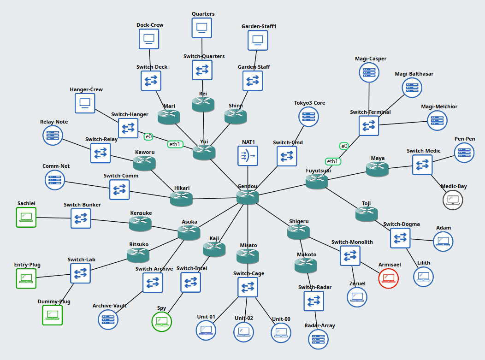
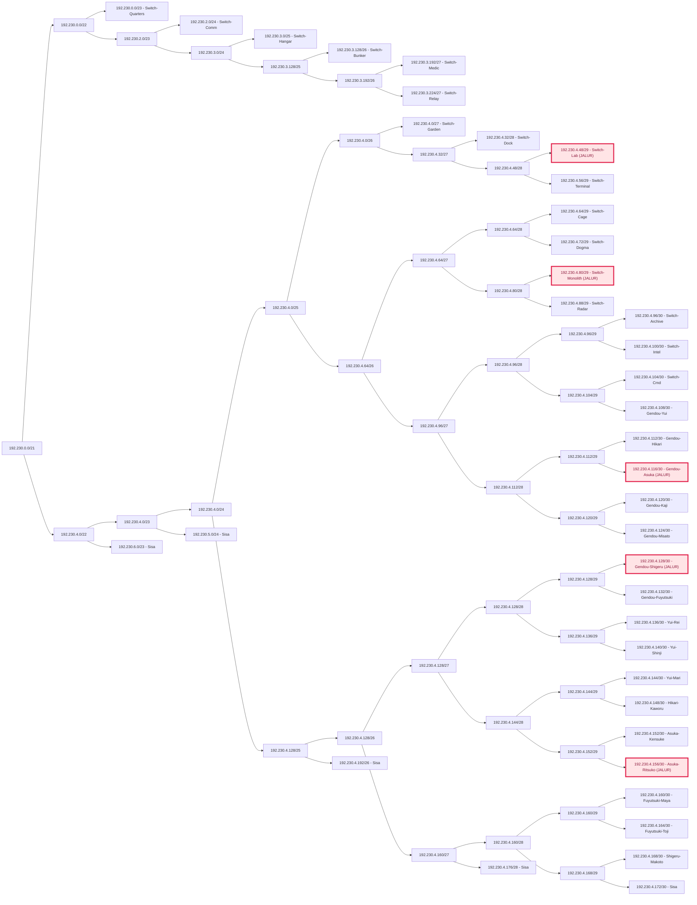

# Jarkom-Modul-5-2026-K-38

**Kelompok:** K-38

### Anggota

| Nama                 | NRP        | Soal  |
| -------------------- | ---------- | ----- |
| Farrel Arteya Kumara | 5027251020 | 1-10  |
| Nayla Arsha Adyuta   | 5027251042 | 11-20 |

<br/>



<br/>

Topologi **Operation Geofront** terdiri dari **17 Router**, **17 Ethernet Switch**, **1 NAT1**, dan **25 Node Host/Server** (total **42 container Docker**):

- **`debinet` (22 node):**
  - Seluruh **17 Router**: `Gendou`, `Yui`, `Hikari`, `Asuka`, `Kaji`, `Misato`, `Shigeru`, `Fuyutsuki`, `Rei`, `Shinji`, `Mari`, `Kaworu`, `Kensuke`, `Ritsuko`, `Makoto`, `Maya`, `Toji`.
  - **5 Server Layanan Aktif**: `Magi-Casper`, `Magi-Balthasar`, `Magi-Melchior`, `Pen-Pen`, `Tokyo3-Core` _(membutuhkan `apt`, `iptables`, `netcat-traditional`, dan `ifupdown`)_.
- **`alpinet` (20 node):**
  - Seluruh **16 Node Client** (`Quarters`, `Dock-Crew`, `Garden-Staff`, `Hangar-Crew`, `Sachiel`, `Entry-Plug`, `Dummy-Plug`, `Spy`, `Unit-01`, `Unit-02`, `Unit-00`, `Lilith`, `Adam`, `Zeruel`, `Armisael`, `Medic-Bay`) serta **4 Node Pasif** (`Comm-Net`, `Relay-Node`, `Archive-Vault`, `Radar-Array`).

<br/>

# Babak 1: Membangun Geofront

## Soal 1: Markas Tanpa Peta (VLSM & Pohon IP)

Markas tanpa peta: tengah malam alarm meraung, dan Ritsuko terdiam. Markas sebesar ini dibangun tanpa peta alamat. Gendo anti pemborosan, jadi tiap subnet memakai prefix terkecil yang muat. Bagi prefix IP kelompokmu dengan VLSM untuk 17 LAN dan 16 link antar-router, urut dari kebutuhan terbesar. Tunjukkan tabel berisi network, prefix, gateway, broadcast, IP terpakai, dan sisa. Tunjukkan juga gambar pohon IP, dengan subnet jalur Dummy-Plug ke Armisael dilingkari. Di laporan, jelaskan hitungan satu subnet.

### Aturan Perhitungan VLSM

1. Setiap LAN membutuhkan `(Jumlah Host) + 1 (Gateway)` alamat usable, atau total `(Jumlah Host) + 3` alamat termasuk Network ID dan Broadcast Address.
2. Pembagian diurutkan dari ukuran blok terbesar (`/23` hingga `/30`).
3. **Tie-break:** Jika ukuran subnet sama, **LAN didahulukan sebelum link antar-router**, lalu mengikuti **urutan Tabel Host**.
4. Untuk 16 link antar-router (`/30`), 7 link langsung milik `Gendou` diletakkan terlebih dahulu (`4.108/30` – `4.132/30`), dilanjutkan 9 link cabang yang dikelompokkan per router induk pada batas `/29` agar menghasilkan **CIDR summarization optimal** pada Soal 3.

### Tabel Pembagian IP VLSM (17 LAN + 16 Link Antar-Router)

|  No | Segmen / Link                     | Router Gateway / Ujung | Kebutuhan (Host+GW) | Network         | Prefix | Gateway / IP Router |       Broadcast | IP Terpakai | Sisa Usable |
| --: | --------------------------------- | ---------------------- | ------------------: | --------------- | ------ | ------------------- | --------------: | ----------: | ----------: |
|   1 | Switch-Quarters                   | Rei                    |                 501 | `192.230.0.0`   | `/23`  | `192.230.0.1`       | `192.230.1.255` |         501 |           9 |
|   2 | Switch-Comm                       | Hikari                 |                 201 | `192.230.2.0`   | `/24`  | `192.230.2.1`       | `192.230.2.255` |         201 |          53 |
|   3 | Switch-Hangar                     | Yui                    |                 101 | `192.230.3.0`   | `/25`  | `192.230.3.1`       | `192.230.3.127` |         101 |          25 |
|   4 | Switch-Bunker                     | Kensuke                |                  56 | `192.230.3.128` | `/26`  | `192.230.3.129`     | `192.230.3.191` |          56 |           6 |
|   5 | Switch-Medic                      | Maya                   |                  27 | `192.230.3.192` | `/27`  | `192.230.3.193`     | `192.230.3.223` |          27 |           3 |
|   6 | Switch-Relay                      | Kaworu                 |                  26 | `192.230.3.224` | `/27`  | `192.230.3.225`     | `192.230.3.255` |          26 |           4 |
|   7 | Switch-Garden                     | Shinji                 |                  15 | `192.230.4.0`   | `/27`  | `192.230.4.1`       |  `192.230.4.31` |          15 |          15 |
|   8 | Switch-Dock                       | Mari                   |                  13 | `192.230.4.32`  | `/28`  | `192.230.4.33`      |  `192.230.4.47` |          13 |           1 |
|   9 | **Switch-Lab** _(jalur)_          | Ritsuko                |                   6 | `192.230.4.48`  | `/29`  | `192.230.4.49`      |  `192.230.4.55` |           6 |           0 |
|  10 | Switch-Terminal                   | Fuyutsuki              |                   4 | `192.230.4.56`  | `/29`  | `192.230.4.57`      |  `192.230.4.63` |           4 |           2 |
|  11 | Switch-Cage                       | Misato                 |                   4 | `192.230.4.64`  | `/29`  | `192.230.4.65`      |  `192.230.4.71` |           4 |           2 |
|  12 | Switch-Dogma                      | Toji                   |                   3 | `192.230.4.72`  | `/29`  | `192.230.4.73`      |  `192.230.4.79` |           3 |           3 |
|  13 | **Switch-Monolith** _(jalur)_     | Shigeru                |                   3 | `192.230.4.80`  | `/29`  | `192.230.4.81`      |  `192.230.4.87` |           3 |           3 |
|  14 | Switch-Radar                      | Makoto                 |                   5 | `192.230.4.88`  | `/29`  | `192.230.4.89`      |  `192.230.4.95` |           5 |           1 |
|  15 | Switch-Archive                    | Asuka                  |                   2 | `192.230.4.96`  | `/30`  | `192.230.4.97`      |  `192.230.4.99` |           2 |           0 |
|  16 | Switch-Intel                      | Kaji                   |                   2 | `192.230.4.100` | `/30`  | `192.230.4.101`     | `192.230.4.103` |           2 |           0 |
|  17 | Switch-Cmd                        | Gendou                 |                   2 | `192.230.4.104` | `/30`  | `192.230.4.105`     | `192.230.4.107` |           2 |           0 |
|  18 | Link Gendou–Yui                   | Gendou / Yui           |                   2 | `192.230.4.108` | `/30`  | `.109` / `.110`     | `192.230.4.111` |           2 |           0 |
|  19 | Link Gendou–Hikari                | Gendou / Hikari        |                   2 | `192.230.4.112` | `/30`  | `.113` / `.114`     | `192.230.4.115` |           2 |           0 |
|  20 | **Link Gendou–Asuka** _(jalur)_   | Gendou / Asuka         |                   2 | `192.230.4.116` | `/30`  | `.117` / `.118`     | `192.230.4.119` |           2 |           0 |
|  21 | Link Gendou–Kaji                  | Gendou / Kaji          |                   2 | `192.230.4.120` | `/30`  | `.121` / `.122`     | `192.230.4.123` |           2 |           0 |
|  22 | Link Gendou–Misato                | Gendou / Misato        |                   2 | `192.230.4.124` | `/30`  | `.125` / `.126`     | `192.230.4.127` |           2 |           0 |
|  23 | **Link Gendou–Shigeru** _(jalur)_ | Gendou / Shigeru       |                   2 | `192.230.4.128` | `/30`  | `.129` / `.130`     | `192.230.4.131` |           2 |           0 |
|  24 | Link Gendou–Fuyutsuki             | Gendou / Fuyutsuki     |                   2 | `192.230.4.132` | `/30`  | `.133` / `.134`     | `192.230.4.135` |           2 |           0 |
|  25 | Link Yui–Rei                      | Yui / Rei              |                   2 | `192.230.4.136` | `/30`  | `.137` / `.138`     | `192.230.4.139` |           2 |           0 |
|  26 | Link Yui–Shinji                   | Yui / Shinji           |                   2 | `192.230.4.140` | `/30`  | `.141` / `.142`     | `192.230.4.143` |           2 |           0 |
|  27 | Link Yui–Mari                     | Yui / Mari             |                   2 | `192.230.4.144` | `/30`  | `.145` / `.146`     | `192.230.4.147` |           2 |           0 |
|  28 | Link Hikari–Kaworu                | Hikari / Kaworu        |                   2 | `192.230.4.148` | `/30`  | `.149` / `.150`     | `192.230.4.151` |           2 |           0 |
|  29 | Link Asuka–Kensuke                | Asuka / Kensuke        |                   2 | `192.230.4.152` | `/30`  | `.153` / `.154`     | `192.230.4.155` |           2 |           0 |
|  30 | **Link Asuka–Ritsuko** _(jalur)_  | Asuka / Ritsuko        |                   2 | `192.230.4.156` | `/30`  | `.157` / `.158`     | `192.230.4.159` |           2 |           0 |
|  31 | Link Fuyutsuki–Maya               | Fuyutsuki / Maya       |                   2 | `192.230.4.160` | `/30`  | `.161` / `.162`     | `192.230.4.163` |           2 |           0 |
|  32 | Link Fuyutsuki–Toji               | Fuyutsuki / Toji       |                   2 | `192.230.4.164` | `/30`  | `.165` / `.166`     | `192.230.4.167` |           2 |           0 |
|  33 | Link Shigeru–Makoto               | Shigeru / Makoto       |                   2 | `192.230.4.168` | `/30`  | `.169` / `.170`     | `192.230.4.171` |           2 |           0 |

### Perhitungan 1 Subnet (`Switch-Garden` — Gateway `Shinji`)

1. **Kebutuhan alamat:** `Garden-Staff` membutuhkan 14 host + 1 alamat untuk router gateway (`Shinji`) = **15 alamat usable**. Ditambah 1 Network ID dan 1 Broadcast Address → total minimal **17 alamat**.
2. **Menentukan bit host ($h$):** Dicari bilangan bulat terkecil $h$ sehingga $2^h - 2 \ge 15$:
   - Jika $h = 4$: $2^4 - 2 = 14 < 15$ _(tidak mencukupi)_.
   - Jika $h = 5$: $2^5 - 2 = 30 \ge 15$ _(mencukupi, ukuran blok = $2^5 = 32$ alamat)_.
3. **Menentukan prefix dan subnet mask:**
   $$\text{Prefix} = 32 - 5 = /27 \quad (\text{Netmask: } 255.255.255.224)$$
4. **Menentukan rentang alamat:** Karena subnet sebelumnya (`Switch-Relay`) berakhir di `192.230.3.255`, maka `Switch-Garden` dimulai pada alamat berikutnya yang merupakan kelipatan 32:
   - **Network ID:** `192.230.4.0/27`
   - **Gateway (usable ke-1, `Shinji eth1`):** `192.230.4.1`
   - **Host `Garden-Staff` (usable ke-2):** `192.230.4.2`
   - **Broadcast Address:** `192.230.4.31` (`4.0 + 32 - 1`)
   - **IP Terpakai:** `15` (14 host + 1 gateway), **Sisa Usable:** `30 - 15 = 15`.

### Pohon Pembagian IP & Subnet Jalur `Dummy-Plug` → `Armisael`

Jalur paket dari **`Dummy-Plug`** (`192.230.4.51`) menuju **`Armisael`** (`192.230.4.83`) melewati **5 subnet** (ditandai merah / dilingkari pada pohon IP):

1. **`192.230.4.48/29`** — `Switch-Lab` (LAN asal `Dummy-Plug`)
2. **`192.230.4.156/30`** — `Link Asuka–Ritsuko`
3. **`192.230.4.116/30`** — `Link Gendou–Asuka`
4. **`192.230.4.128/30`** — `Link Gendou–Shigeru`
5. **`192.230.4.80/29`** — `Switch-Monolith` (LAN tujuan `Armisael`)



<br/>

## Soal 2: Geofront Gelap Gulita (Topologi, IP Router & IP Forwarding)

Geofront gelap gulita: kabel sudah ditarik, tapi saat Misato menekan tombol daya, Geofront tetap gelap. Tidak ada alamat dan tidak ada rute. Pasang semua node di GNS3 sesuai topologi. Beri IP ke tiap interface router sesuai soal 1, lalu aktifkan IP forwarding di semua router. Hanya Gendo yang terhubung ke NAT1 dan mendapat alamat lewat DHCP. Router lain baru bisa memasang paket setelah soal 4, karena internet baru ada saat itu. Tunjukkan ip -br di tiap router dan ping dua ujung tiap link router ke router.

| Router        | Adapter | Pemetaan Interface & Alamat IP                                                                                                                                                                                                             |
| ------------- | ------: | ------------------------------------------------------------------------------------------------------------------------------------------------------------------------------------------------------------------------------------------ |
| **Gendou**    |       9 | `eth0`→NAT1 (DHCP), `eth1`→`192.230.4.105/30`, `eth2`→`192.230.4.109/30`, `eth3`→`192.230.4.113/30`, `eth4`→`192.230.4.117/30`, `eth5`→`192.230.4.121/30`, `eth6`→`192.230.4.125/30`, `eth7`→`192.230.4.129/30`, `eth8`→`192.230.4.133/30` |
| **Yui**       |       5 | `eth0`→`192.230.4.110/30`, `eth1`→`192.230.3.1/25`, `eth2`→`192.230.4.137/30`, `eth3`→`192.230.4.141/30`, `eth4`→`192.230.4.145/30`                                                                                                        |
| **Hikari**    |       3 | `eth0`→`192.230.4.114/30`, `eth1`→`192.230.2.1/24`, `eth2`→`192.230.4.149/30`                                                                                                                                                              |
| **Asuka**     |       4 | `eth0`→`192.230.4.118/30`, `eth1`→`192.230.4.97/30`, `eth2`→`192.230.4.153/30`, `eth3`→`192.230.4.157/30`                                                                                                                                  |
| **Kaji**      |       2 | `eth0`→`192.230.4.122/30`, `eth1`→`192.230.4.101/30`                                                                                                                                                                                       |
| **Misato**    |       2 | `eth0`→`192.230.4.126/30`, `eth1`→`192.230.4.65/29`                                                                                                                                                                                        |
| **Shigeru**   |       3 | `eth0`→`192.230.4.130/30`, `eth1`→`192.230.4.81/29`, `eth2`→`192.230.4.169/30`                                                                                                                                                             |
| **Fuyutsuki** |       4 | `eth0`→`192.230.4.134/30`, `eth1`→`192.230.4.57/29`, `eth2`→`192.230.4.161/30`, `eth3`→`192.230.4.165/30`                                                                                                                                  |
| **Rei**       |       2 | `eth0`→`192.230.4.138/30`, `eth1`→`192.230.0.1/23`                                                                                                                                                                                         |
| **Shinji**    |       2 | `eth0`→`192.230.4.142/30`, `eth1`→`192.230.4.1/27`                                                                                                                                                                                         |
| **Mari**      |       2 | `eth0`→`192.230.4.146/30`, `eth1`→`192.230.4.33/28`                                                                                                                                                                                        |
| **Kaworu**    |       2 | `eth0`→`192.230.4.150/30`, `eth1`→`192.230.3.225/27`                                                                                                                                                                                       |
| **Kensuke**   |       2 | `eth0`→`192.230.4.154/30`, `eth1`→`192.230.3.129/26`                                                                                                                                                                                       |
| **Ritsuko**   |       2 | `eth0`→`192.230.4.158/30`, `eth1`→`192.230.4.49/29`                                                                                                                                                                                        |
| **Makoto**    |       2 | `eth0`→`192.230.4.170/30`, `eth1`→`192.230.4.89/29`                                                                                                                                                                                        |
| **Maya**      |       2 | `eth0`→`192.230.4.162/30`, `eth1`→`192.230.3.193/27`                                                                                                                                                                                       |
| **Toji**      |       2 | `eth0`→`192.230.4.166/30`, `eth1`→`192.230.4.73/29`                                                                                                                                                                                        |

### Verifikasi

Setiap router diverifikasi dengan `ip -br a`, `sysctl net.ipv4.ip_forward` (`= 1`), dan uji ping pada dua ujung seluruh 16 link router-ke-router:

- **`ip -br a` dan `sysctl net.ipv4.ip_forward` pada `Gendou`** (`eth0` mendapat IP DHCP dari NAT1 `192.168.122.61/24`, `eth1`–`eth8` aktif sesuai Soal 1, dan `net.ipv4.ip_forward = 1`):


- **Uji ping antar-ujung link router-ke-router dari `Gendou`** menuju seluruh 7 router cabang langsung (`.110`, `.114`, `.118`, `.122`, `.126`, `.130`, `.134` — **0% packet loss**):


<br/>

## Soal 3: Pulau-Pulau yang Terpisah (Static Routing & CIDR Summarization)

Pulau-pulau yang terpisah: lampu mulai menyala, tapi tiap segmen masih seperti pulau terpisah. Fuyutsuki mengingatkan: bangun jalur dari Gendo ke bawah, cabang demi cabang. Hubungkan semua subnet dengan routing statis dan jumlah rute sesedikit mungkin. Router selain Gendo cukup punya satu default route ke atas dan rute untuk subnet di bawahnya. Gendo memakai default route ke NAT1. Subnet satu cabang yang bisa digabung tepat menjadi satu CIDR harus diringkas. Untuk soal 3 sampai 5, beri IP dan gateway sementara pada node uji. IP permanen dibuat di soal 6. Buktikan Armisael bisa ping ke Lilith, Sachiel, dan Comm-Net.

### Ringkasan Rute (CIDR Summarization) di `Gendou`

Seluruh 16 router bawahan cukup memiliki **1 default route ke atas** ditambah rute spesifik ke subnet di bawahnya. Pada `Gendou`, 4 pasang subnet yang berada pada cabang yang sama dan bersebelahan pada batas bit CIDR diringkas tepat menjadi satu rute, sehingga dari 25 subnet bawahan hanya dibutuhkan **21 static route** (+ 1 default route DHCP ke NAT1):

| Cabang        | Subnet yang Digabung                                                      | CIDR Ringkasan         | Next-Hop        |
| ------------- | ------------------------------------------------------------------------- | ---------------------- | --------------- |
| **Shigeru**   | `192.230.4.80/29` (Switch-Monolith) + `192.230.4.88/29` (Switch-Radar)    | **`192.230.4.80/28`**  | `192.230.4.130` |
| **Yui**       | `192.230.4.136/30` (Yui–Rei) + `192.230.4.140/30` (Yui–Shinji)            | **`192.230.4.136/29`** | `192.230.4.110` |
| **Asuka**     | `192.230.4.152/30` (Asuka–Kensuke) + `192.230.4.156/30` (Asuka–Ritsuko)   | **`192.230.4.152/29`** | `192.230.4.118` |
| **Fuyutsuki** | `192.230.4.160/30` (Fuyutsuki–Maya) + `192.230.4.164/30` (Fuyutsuki–Toji) | **`192.230.4.160/29`** | `192.230.4.134` |

### Rute Statis per Router (`<nama>.sh`)

- **`Gendou`:** 21 rute `ip route replace` (4 CIDR summary + 17 subnet lainnya) menuju 7 router cabang + `default` via `NAT1`.
- **`Yui`:** `default via 192.230.4.109`, `192.230.0.0/23 via .4.138`, `192.230.4.0/27 via .4.142`, `192.230.4.32/28 via .4.146`.
- **`Hikari`:** `default via 192.230.4.113`, `192.230.3.224/27 via .4.150`.
- **`Asuka`:** `default via 192.230.4.117`, `192.230.3.128/26 via .4.154`, `192.230.4.48/29 via .4.158`.
- **`Shigeru`:** `default via 192.230.4.129`, `192.230.4.88/29 via .4.170`.
- **`Fuyutsuki`:** `default via 192.230.4.133`, `192.230.3.192/27 via .4.162`, `192.230.4.72/29 via .4.166`.
- **11 Router Leaf** (`Kaji`, `Misato`, `Rei`, `Shinji`, `Mari`, `Kaworu`, `Kensuke`, `Ritsuko`, `Makoto`, `Maya`, `Toji`): masing-masing cukup 1 `default route` ke router induknya.

### Pengujian Soal 3

Pengujian dilakukan dari **`Armisael`** (`192.230.4.83`) menuju **`Lilith`** (`192.230.4.74`), **`Sachiel`** (`192.230.3.130`), dan **`Comm-Net`** (`192.230.2.2`). Ketiganya berhasil dengan **0% packet loss**:


<br/>

## Soal 4: Haus Kabar dari Dunia Luar (NAT Masquerade & DNS)

Haus kabar dari dunia luar: Maya melapor bahwa semua sistem butuh update dari luar, padahal pintu keluarnya hanya Gendo. IP dari NAT1 juga bisa berganti kapan saja. Beri seluruh jaringan akses internet lewat Gendo. Konfigurasinya tidak boleh perlu diubah saat IP NAT1 berganti. Hanya traffic dari prefix internal yang keluar lewat NAT1 yang boleh diterjemahkan alamatnya, sedangkan traffic antar-LAN harus tetap membawa alamat asli pengirimnya. Node yang nanti memasang paket juga harus bisa me-resolve nama domain. Selesaikan sebelum node lain memasang paket. Buktikan ping 8.8.8.8 dan ping deb.debian.org dari Armisael dan Lilith berhasil, dan tunjukkan counter rule NAT.

### Konfigurasi di `Gendou`

Agar seluruh jaringan internal dapat mengakses internet melalui `Gendou` tanpa perlu mengubah rule saat IP DHCP `NAT1` berubah, digunakan target **`MASQUERADE`** yang dibatasi hanya untuk prefix internal keluar lewat interface `eth0`:

```bash
echo "nameserver 8.8.8.8" > /etc/resolv.conf
apt update && apt install -y ifupdown iptables conntrack
iptables -t nat -A POSTROUTING -s 192.230.0.0/16 -o eth0 -j MASQUERADE
```

- **`-j MASQUERADE`**: secara dinamis mengikuti IP `eth0` dari DHCP `NAT1`.
- **`-s 192.230.0.0/16 -o eth0`**: hanya menerjemahkan paket dari prefix internal yang keluar menuju `NAT1`; lalu lintas antar-LAN keluar lewat `eth1`–`eth8` sehingga mempertahankan alamat IP asli pengirim.
- **DNS Resolver**: diatur `nameserver 8.8.8.8` di `/etc/resolv.conf` agar seluruh node dapat me-resolve nama domain seperti `deb.debian.org`.

### Bukti Pengujian Soal 4

- **`Armisael`** berhasil `ping 8.8.8.8` (**0% packet loss**):


**`Lilith`** berhasil `ping 8.8.8.8` (**0% packet loss**):


**Counter rule NAT `MASQUERADE` di `Gendou`** (`iptables -t nat -L POSTROUTING -n -v`) naik menjadi `33 pkts, 2262 bytes`:


<br/>

## Soal 5: Pintu Depan Dikunci Rapat (Stateful Firewall Gendou)

Pintu depan dikunci rapat: Kaji memperingatkan Kaworu bahwa SEELE cukup mengetuk pintu depan. Gendo mengunci NAT1: boleh keluar, tidak boleh dimasuki. Di Gendo, ubah policy INPUT dan FORWARD menjadi DROP. Lalu izinkan empat hal: (a) balasan koneksi yang sudah ada, (b) traffic dari jaringan internal ke internet, (c) traffic antar-LAN, dan (d) traffic dari jaringan internal ke Gendo sendiri. Loopback dan DHCP dari NAT1 juga harus tetap jalan. Koneksi baru dari sisi NAT1 tidak boleh masuk. Soal 2 sampai 4 harus tetap jalan, dan semuanya ditulis di gendo.sh. Tunjukkan iptables -S di Gendo, dan buktikan ping 8.8.8.8 dari Armisael masih berhasil.

```bash
#!/bin/bash
set -e

INTERNAL_NET="192.230.0.0/16"
WAN_IF="eth0"

sysctl -w net.ipv4.ip_forward=1
echo "nameserver 8.8.8.8" > /etc/resolv.conf

# Static Routing (Soal 3)
ip route replace 192.230.0.0/23   via 192.230.4.110
ip route replace 192.230.3.0/25   via 192.230.4.110
ip route replace 192.230.4.0/27   via 192.230.4.110
ip route replace 192.230.4.32/28  via 192.230.4.110
ip route replace 192.230.4.136/29 via 192.230.4.110
ip route replace 192.230.4.144/30 via 192.230.4.110
ip route replace 192.230.2.0/24   via 192.230.4.114
ip route replace 192.230.3.224/27 via 192.230.4.114
ip route replace 192.230.4.148/30 via 192.230.4.114
ip route replace 192.230.3.128/26 via 192.230.4.118
ip route replace 192.230.4.48/29  via 192.230.4.118
ip route replace 192.230.4.96/30  via 192.230.4.118
ip route replace 192.230.4.152/29 via 192.230.4.118
ip route replace 192.230.4.100/30 via 192.230.4.122
ip route replace 192.230.4.64/29  via 192.230.4.126
ip route replace 192.230.4.80/28  via 192.230.4.130
ip route replace 192.230.4.168/30 via 192.230.4.130
ip route replace 192.230.3.192/27 via 192.230.4.134
ip route replace 192.230.4.56/29  via 192.230.4.134
ip route replace 192.230.4.72/29  via 192.230.4.134
ip route replace 192.230.4.160/29 via 192.230.4.134

# Reset aman iptables
iptables -P INPUT ACCEPT
iptables -P FORWARD ACCEPT
iptables -P OUTPUT ACCEPT
iptables -F && iptables -X
iptables -t nat -F && iptables -t nat -X

# INPUT: loopback, (a) ESTABLISHED/RELATED, DHCP NAT1, (d) internal ke Gendou
iptables -A INPUT -i lo -j ACCEPT
iptables -A INPUT -m conntrack --ctstate ESTABLISHED,RELATED -j ACCEPT
iptables -A INPUT -i "$WAN_IF" -p udp --sport 67 --dport 68 -j ACCEPT
iptables -A INPUT ! -i "$WAN_IF" -s "$INTERNAL_NET" -j ACCEPT

# FORWARD: (a) ESTABLISHED/RELATED, (b) internal ke internet, (c) antar-LAN
iptables -A FORWARD -m conntrack --ctstate ESTABLISHED,RELATED -j ACCEPT
iptables -A FORWARD ! -i "$WAN_IF" -o "$WAN_IF" -s "$INTERNAL_NET" -j ACCEPT
iptables -A FORWARD ! -i "$WAN_IF" ! -o "$WAN_IF" -s "$INTERNAL_NET" -d "$INTERNAL_NET" -j ACCEPT

# Policy INPUT & FORWARD = DROP (koneksi baru dari NAT1 otomatis ditolak)
iptables -P INPUT DROP
iptables -P FORWARD DROP
iptables -P OUTPUT ACCEPT

# NAT Masquerade (Soal 4)
iptables -t nat -A POSTROUTING -s "$INTERNAL_NET" -o "$WAN_IF" -j MASQUERADE
```

### Pengujian Soal 5

Setelah firewall `DROP` diaktifkan pada `Gendou`, pengujian `ping 8.8.8.8` dan `ping 192.230.4.74` (`Lilith`) dari `Armisael` tetap berhasil **0% packet loss**:


<br/>

## Soal 6: Alamat Para Pilot (IP Statis Permanen Non-Router)

Alamat para pilot: jaringan sudah hidup, tapi para pilot dan staf tidak tahu alamat mereka sendiri. Unit-01 bahkan tidak tahu siapa gateway-nya. Beri IP statis dan gateway ke semua node non-router, sesuai aturan alamat di glosarium. Simpan agar bertahan setelah restart. Tunjukkan ip -br dan ping ke gateway di Unit-01.

Seluruh **25 node non-router** diberi IP statis dan gateway permanen melalui `/etc/network/interfaces` sesuai aturan urutan Glosarium (gateway = usable ke-1, host = usable berikutnya kiri ke kanan):

| Switch          | Node             | Image     | IP Address      | Netmask           | Gateway         |
| --------------- | ---------------- | --------- | --------------- | ----------------- | --------------- |
| Switch-Quarters | `Quarters`       | `alpinet` | `192.230.0.2`   | `255.255.254.0`   | `192.230.0.1`   |
| Switch-Comm     | `Comm-Net`       | `alpinet` | `192.230.2.2`   | `255.255.255.0`   | `192.230.2.1`   |
| Switch-Hangar   | `Hangar-Crew`    | `alpinet` | `192.230.3.2`   | `255.255.255.128` | `192.230.3.1`   |
| Switch-Bunker   | `Sachiel`        | `alpinet` | `192.230.3.130` | `255.255.255.192` | `192.230.3.129` |
| Switch-Medic    | `Pen-Pen`        | `debinet` | `192.230.3.194` | `255.255.255.224` | `192.230.3.193` |
| Switch-Medic    | `Medic-Bay`      | `alpinet` | `192.230.3.195` | `255.255.255.224` | `192.230.3.193` |
| Switch-Relay    | `Relay-Node`     | `alpinet` | `192.230.3.226` | `255.255.255.224` | `192.230.3.225` |
| Switch-Garden   | `Garden-Staff`   | `alpinet` | `192.230.4.2`   | `255.255.255.224` | `192.230.4.1`   |
| Switch-Dock     | `Dock-Crew`      | `alpinet` | `192.230.4.34`  | `255.255.255.240` | `192.230.4.33`  |
| Switch-Lab      | `Entry-Plug`     | `alpinet` | `192.230.4.50`  | `255.255.255.248` | `192.230.4.49`  |
| Switch-Lab      | `Dummy-Plug`     | `alpinet` | `192.230.4.51`  | `255.255.255.248` | `192.230.4.49`  |
| Switch-Terminal | `Magi-Casper`    | `debinet` | `192.230.4.58`  | `255.255.255.248` | `192.230.4.57`  |
| Switch-Terminal | `Magi-Balthasar` | `debinet` | `192.230.4.59`  | `255.255.255.248` | `192.230.4.57`  |
| Switch-Terminal | `Magi-Melchior`  | `debinet` | `192.230.4.60`  | `255.255.255.248` | `192.230.4.57`  |
| Switch-Cage     | `Unit-01`        | `alpinet` | `192.230.4.66`  | `255.255.255.248` | `192.230.4.65`  |
| Switch-Cage     | `Unit-02`        | `alpinet` | `192.230.4.67`  | `255.255.255.248` | `192.230.4.65`  |
| Switch-Cage     | `Unit-00`        | `alpinet` | `192.230.4.68`  | `255.255.255.248` | `192.230.4.65`  |
| Switch-Dogma    | `Lilith`         | `alpinet` | `192.230.4.74`  | `255.255.255.248` | `192.230.4.73`  |
| Switch-Dogma    | `Adam`           | `alpinet` | `192.230.4.75`  | `255.255.255.248` | `192.230.4.73`  |
| Switch-Monolith | `Zeruel`         | `alpinet` | `192.230.4.82`  | `255.255.255.248` | `192.230.4.81`  |
| Switch-Monolith | `Armisael`       | `alpinet` | `192.230.4.83`  | `255.255.255.248` | `192.230.4.81`  |
| Switch-Radar    | `Radar-Array`    | `alpinet` | `192.230.4.90`  | `255.255.255.248` | `192.230.4.89`  |
| Switch-Archive  | `Archive-Vault`  | `alpinet` | `192.230.4.98`  | `255.255.255.252` | `192.230.4.97`  |
| Switch-Intel    | `Spy`            | `alpinet` | `192.230.4.102` | `255.255.255.252` | `192.230.4.101` |
| Switch-Cmd      | `Tokyo3-Core`    | `debinet` | `192.230.4.106` | `255.255.255.252` | `192.230.4.105` |

### Pengujian Soal 6 (`Unit-01` Setelah Restart)

`ip -br a` menampilkan `192.230.4.66/29` pada `eth0` dan `ping` ke gateway `Misato` (`192.230.4.65`) berhasil **0% packet loss**:


<br/>

## Soal 7: Membangunkan MAGI

Membangunkan MAGI: Casper, Balthasar, dan Melchior di Switch-Terminal menunggu diaktifkan. Ritsuko ingin ketiganya melayani dulu, urusan keamanan dibahas nanti. Pasang iptables dan netcat-traditional lewat /root/<nama>.sh, lalu nyalakan listener sesuai port di glosarium. Dari Lilith, kirim pesan ke ketiganya dan ke port 5001 Balthasar. Tampilkan pesan yang diterima di tiap node.

Pada `Magi-Casper` (`192.230.4.58`), `Magi-Balthasar` (`192.230.4.59`), dan `Magi-Melchior` (`192.230.4.60`), dipasang `ifupdown`, `iptables`, dan `netcat-traditional` melalui `<nama>.sh`, lalu dijalankan listener `nc.traditional` sesuai port Glosarium (`Casper`: `5000`, `Balthasar`: `5000` & `5001`, `Melchior`: `5000`).

Script `magi-balthasar.sh`

```bash
#!/bin/bash
echo "nameserver 8.8.8.8" > /etc/resolv.conf
rm -f /etc/apt/sources.list /etc/apt/sources.list.d/*.list /etc/apt/sources.list.d/*.sources
cat << 'REPO' > /etc/apt/sources.list.d/debian.sources
Types: deb
URIs: http://deb.debian.org/debian
Suites: trixie trixie-updates
Components: main
Signed-By: /usr/share/keyrings/debian-archive-keyring.gpg
REPO
which nc.traditional >/dev/null 2>&1 || (apt-get update && apt-get install -y ifupdown iptables netcat-traditional)

pkill -f "nc.traditional -l -p 5000" 2>/dev/null || true
pkill -f "nc.traditional -l -p 5001" 2>/dev/null || true
nohup bash -c 'while true; do nc.traditional -l -p 5000; done' >> /tmp/balthasar_5000.txt 2>&1 &
nohup bash -c 'while true; do nc.traditional -l -p 5001; done' >> /tmp/balthasar_5001.txt 2>&1 &
```

### Pengujian Soal 7

Pengiriman pesan dari `Lilith` ke ketiga node MAGI dan port `5001` Balthasar seluruhnya selesai dengan **`exit=0`**:


<br/>

## Soal 8: Mengenali Kondisi Normal (`Pen-Pen` & `Tokyo3-Core`)

Mengenali kondisi normal: Pen-Pen dan Tokyo3-Core sudah ditandai sebagai calon sasaran pertama SEELE. Sebelum dilindungi, keduanya harus melayani dulu agar kamu tahu kondisi normalnya. Koneksi ke port 80 dijawab Welcome to {hostname}. Koneksi ke port 8080 di Tokyo3-Core dijawab syifa imutz. Tunjukkan nc dari Lilith ke ketiga port itu. Tunjukkan juga bahwa port yang tidak dilayani, misalnya 22, langsung gagal, bukan menggantung.

### Pengujian Soal 8

Pengujian dari **`Lilith`** ke ketiga port layanan berhasil (`Welcome to Pen-Pen`, `Welcome to Tokyo3-Core`, `syifa imutz` dengan `exit=0`), sedangkan koneksi ke port `22` langsung gagal seketika (`real 0m0.004s` dan `0m0.003s`, `exit=1`):


<br/>

# Babak 2: Sabotase dan Hantu MAGI

## Soal 9: Jalur Belakang Diutak-atik (`break_routing.sh` di `Shigeru`)

Jalur belakang diutak-atik: tengah malam masuk laporan bahwa ada yang mengutak-atik jalur belakang di sekitar Shigeru. Lilith tidak mendapat jawaban dari Armisael, padahal Armisael masih bisa ping gateway-nya sendiri. Jalankan break_routing.sh di Shigeru. Buktikan Lilith bisa ping Armisael kembali setelah perbaikan.

### 1. Eksekusi Sabotase & Verifikasi Gejala

Script `break_routing.sh` dijalankan langsung di **`Shigeru`** tanpa membaca isinya:


Gejala yang muncul sesuai skenario soal:
**`Armisael` masih bisa ping gateway-nya sendiri (`Shigeru` `192.230.4.81`)** dengan 0% packet loss:


**`Lilith` (`192.230.4.74`) gagal ping ke `Armisael` (`192.230.4.83`)** dengan 100% packet loss:


### 2. Hasil Diagnostik di `Shigeru` & Temuan 4 Penyebab Sabotase

Pemeriksaan dilakukan dengan `sysctl net.ipv4.ip_forward`, `ip -br a`, `ip route show`, `ip rule show`, `iptables -S`, dan `ping 192.230.4.129`:


Ditemukan **4 penyebab sekaligus** pada `Shigeru`:

1. **`net.ipv4.ip_forward = 0`** — Fitur forwarding kernel dimatikan sehingga `Shigeru` tidak meneruskan paket lintas interface (`eth0` ↔ `eth1`).
2. **`default via 192.230.4.170 dev eth2`** — Default route dibelokkan ke router bawahan **`Makoto`** (`192.230.4.170` via `eth2`), bukan ke **`Gendou`** (`192.230.4.129` via `eth0`), sehingga menimbulkan _routing loop_ `Shigeru ↔ Makoto`.
3. **`blackhole 192.230.4.72/29`** — Ditanam rute `blackhole` khusus ke subnet `Switch-Dogma` (`Lilith`), sehingga paket balasan ke `Lilith` langsung dibuang diam-diam.
4. **`90: from all iif eth1 lookup 100`** — Ditambahkan aturan _policy routing_ (`ip rule`) berprioritas `90` yang mengalihkan seluruh paket masuk dari `eth1` (`Switch-Monolith`) ke tabel routing `100` sebelum mencapai tabel `main`.

### 3. Perbaikan & Pembuktian

Seluruh penyebab dibersihkan (`ip rule del pref 90`, `ip route del blackhole 192.230.4.72/29`, mengaktifkan `net.ipv4.ip_forward = 1`, dan memulihkan `default via 192.230.4.129 dev eth0` melalui `shigeru.sh`):


Setelah perbaikan, `ping` dari **`Lilith`** ke **`Armisael`** (`192.230.4.83`) kembali berhasil dengan **0% packet loss**:


---

## Soal 10: Para Pilot Terkunci di Dalam (`break_nat.sh` di `Misato` & `Gendou`)

Para pilot terkunci di dalam: paginya giliran para pilot mengeluh. Unit-01, Unit-02, dan Unit-00 di Cage tidak bisa ping 8.8.8.8. Padahal Spy di Intel baik-baik saja, dan ping dari Cage ke Lilith normal. Jalankan break_nat.sh di Misato dan di Gendo. Filenya sama, dijalankan di masing-masing node. Jelaskan kenapa Cage terdampak tapi Intel tidak. Buktikan Unit-01 bisa ping 8.8.8.8, dan sebutkan di router mana alamat sumber diterjemahkan.

### 1. Verifikasi Gejala Setelah Menjalankan `break_nat.sh`

Setelah `break_nat.sh` dijalankan pada `Misato` dan `Gendou`:

- Di **`Unit-01`** (`Switch-Cage`): `ping 8.8.8.8` **gagal (100% packet loss)**, sedangkan `ping 192.230.4.74` (`Lilith`) **normal (0% packet loss)**:


- Di **`Spy`** (`Switch-Intel`): `ping 8.8.8.8` **tetap berhasil (0% packet loss)**:


### 2. Hasil Diagnostik di `Misato` dan `Gendou` & Temuan 2 Penyebab Sabotase

**Diagnostik di `Misato`:**


Ditemukan **Penyebab #1 (di `Misato`)**:

```text
-A POSTROUTING -s 192.230.4.64/29 ! -d 192.230.0.0/16 -o eth0 -j SNAT --to-source 172.31.99.1
```

Router internal `Misato` melakukan **`SNAT`** mengubah IP sumber paket dari `Switch-Cage` (`192.230.4.64/29`) yang menuju keluar prefix internal (`! -d 192.230.0.0/16`, termasuk `8.8.8.8`) menjadi **`172.31.99.1`** (terbukti counter `1 pkts, 84 bytes`).

**Diagnostik di `Gendou`:**


Ditemukan **Penyebab #2 (di `Gendou`)**:

```text
-A POSTROUTING -s 192.230.4.64/29 -o eth0 -j RETURN
-A POSTROUTING -s 192.230.0.0/16 -o eth0 -j MASQUERADE
```

Pada tabel `nat` `Gendou`, disisipkan rule **`-j RETURN`** untuk subnet `Cage` (`192.230.4.64/29`) tepat **di atas** rule `MASQUERADE`. Selain itu, pada `Chain FORWARD` terlihat `policy DROP 2 packets, 168 bytes` — bukti bahwa paket dari `Cage` yang alamat sumbernya sudah diubah `Misato` menjadi `172.31.99.1` tidak cocok lagi dengan `-s 192.230.0.0/16` di `Gendou` sehingga langsung dibuang oleh policy `FORWARD DROP`.

### 3. Penjelasan Lengkap

- **Mengapa `Cage` terdampak tetapi `Intel` tidak?**
  1. `Switch-Cage` (`192.230.4.64/29`) berada di bawah **`Misato`** (tempat `break_nat.sh` menanam rule `SNAT --to-source 172.31.99.1`), sedangkan `Switch-Intel` (`192.230.4.100/30`) berada di bawah **`Kaji`** yang jalurnya terpisah dan tidak tersentuh sabotase.
  2. Di **`Gendou`**, rule `-j RETURN` di `POSTROUTING` juga hanya menyasar `-s 192.230.4.64/29` (`Cage`), sehingga paket dari `Intel` (`192.230.4.102`) tetap lolos `FORWARD` dan tetap diterjemahkan oleh `MASQUERADE`.
- **Mengapa ping dari `Cage` ke `Lilith` tetap normal?**
  - Karena tujuan `Lilith` (`192.230.4.74`) termasuk dalam `192.230.0.0/16`, paket **tidak cocok** dengan kriteria `! -d 192.230.0.0/16` pada rule `SNAT` di `Misato`, sehingga alamat sumbernya tetap asli (`192.230.4.66`), lolos rule antar-LAN di `Gendou`, dan tidak keluar melalui `eth0` (tidak melewati rule NAT `POSTROUTING` `Gendou`).
- **Di router mana alamat sumber diterjemahkan?**
  - Alamat sumber **hanya boleh diterjemahkan di router `Gendou`** pada tabel `nat` chain `POSTROUTING` melalui rule `-s 192.230.0.0/16 -o eth0 -j MASQUERADE` saat keluar menuju `NAT1`. Router internal seperti `Misato` tidak boleh melakukan `SNAT`/`MASQUERADE`.

### 4. Perbaikan & Pembuktian

Rule sabotase pada `Misato` dibersihkan (`iptables -t nat -F`, `iptables -F`, `iptables -t mangle -F`, lalu `bash misato.sh`) dan `Gendou` dipulihkan melalui `bash gendo.sh`:


Verifikasi tabel `nat` setelah perbaikan:
**`Gendou`** hanya memiliki 1 rule `MASQUERADE` pada `POSTROUTING` (rule `RETURN` sudah terhapus dan counter naik):


**`Misato`** memiliki tabel `nat` yang sepenuhnya bersih (tidak ada lagi `SNAT`):


---

## Soal 11: Casper Harus Jadi Hantu (Blokir Ping Masuk)

Casper harus jadi hantu: Casper adalah MAGI paling rahasia. Kalau SEELE tahu ia masih hidup, mereka tahu ke mana harus menyerang. Tidak ada perangkat lain yang boleh mem-ping Casper, termasuk yang satu switch. Casper sendiri tetap boleh mem-ping siapa saja. Layanan TCP 5000 Casper tetap hidup. Buktikan ping ke Casper dari Balthasar dan Lilith gagal, sedangkan ping dari Casper ke keduanya berhasil.

### Konfigurasi di `Magi-Casper`

Rule dipasang di chain `INPUT`, karena yang ingin diblokir adalah **ping yang masuk ke Casper**. Semua sumber (termasuk tetangga satu switch) ikut terblokir karena rule tidak menyebut alamat sumber:

```bash
iptables -A INPUT -p icmp --icmp-type echo-request -j DROP
```

- **`--icmp-type echo-request`**: hanya permintaan ping (type 8) yang dibuang. Balasan ping (`echo-reply`, type 0) tidak ikut dibuang.
- **Casper tetap bisa ping keluar**: permintaan ping Casper keluar lewat chain `OUTPUT` (tidak disentuh), dan balasan yang kembali tidak cocok dengan rule di atas.
- **TCP 5000 tetap hidup**: rule hanya menyasar ICMP, jadi listener `nc.traditional` pada port `5000` tidak terpengaruh.

Rule ini kemudian dilebur ke dalam `/root/casper-fw.sh` versi akhir (lihat Soal 12).

### Pengujian Soal 11

Rule terpasang di `Casper`:


`ping` dari **`Balthasar`** dan **`Lilith`** ke `Casper` (`192.230.4.58`) **gagal (100% packet loss)**:


`ping` dari **`Casper`** ke `Balthasar` (`192.230.4.59`) dan `Lilith` (`192.230.4.74`) **berhasil (0% packet loss)**:


Layanan TCP `5000` Casper tetap hidup (`nc` dari `Lilith` berhasil, `exit=0`), dan counter rule `DROP` naik (`iptables -L INPUT -n -v`):


<br/>

## Soal 12: Teknisi yang Kelewat Semangat (`break_fw.sh` di `Magi-Casper`)

Teknisi yang kelewat semangat: seorang teknisi menjalankan script hardening di Casper lalu pulang tanpa mengecek. Paginya Casper tidak bisa ping 8.8.8.8 dan tidak bisa apt-get update. Unit-00 juga tidak bisa menyambung ke TCP 5000 Casper. Ping ke Casper tetap ditolak, dan itu memang benar. Jalankan break_fw.sh di Magi-Casper, lalu perbaiki tanpa membatalkan tujuan hardening. Casper tetap menolak semua lalu lintas masuk yang tidak diizinkan, dan policy INPUT tetap DROP. Buktikan nc dari Unit-00 ke Casper port 5000 berhasil dan apt-get update di Casper berhasil.

### 1. Eksekusi Sabotase & Verifikasi Gejala

Sebelum sabotase, rule Casper dicadangkan (`iptables-save > /root/casper-sebelum-break.rules`), lalu `break_fw.sh` dijalankan di **`Magi-Casper`** tanpa membaca isinya:


Gejala yang muncul sesuai soal: `ping 8.8.8.8` gagal (100% packet loss) dan `apt-get update` gagal (`Temporary failure resolving 'deb.debian.org'`):


`nc` dari `Unit-00` ke `Casper` port `5000` gagal setelah menunggu sampai timeout (`exit=1`, `real` sekitar 2 detik, ciri paket yang di-`DROP`):


### 2. Hasil Diagnostik di `Magi-Casper` & Temuan Penyebab

Diagnostik dengan `iptables -S`, `iptables -t nat -S`, `iptables -t mangle -S`, `ip route`, dan `cat /etc/resolv.conf`:


Tabel `nat` dan `mangle` bersih, route (`default via 192.230.4.57`) dan `resolv.conf` (`nameserver 8.8.8.8`) normal. Penyebab ada pada tabel `filter`:

```text
-P INPUT DROP
-A INPUT -i lo -j ACCEPT
-A INPUT -p icmp -j DROP
-A OUTPUT -p udp -m udp --dport 53 -j DROP
```

1. **`-A INPUT -p icmp -j DROP`** membuang **semua** ICMP yang masuk, termasuk `echo-reply`. Casper tetap mengirim ping ke 8.8.8.8 tetapi balasannya dibuang, sehingga `ping 8.8.8.8` gagal.
2. **`-A OUTPUT -p udp --dport 53 -j DROP`** membuang semua query DNS keluar, sehingga `apt-get update` gagal me-resolve `deb.debian.org`.
3. **Tidak ada rule `ESTABLISHED,RELATED`** di atas policy `INPUT DROP`, sehingga balasan koneksi yang dimulai Casper sendiri (misalnya TCP untuk `apt`) ikut dibuang.
4. **Tidak ada rule yang mengizinkan TCP `5000`**, sehingga `Unit-00` ter-`DROP` dan menggantung sampai timeout.

### 3. Perbaikan di `/root/casper-fw.sh`

Tujuan hardening tetap dipertahankan: policy `INPUT` tetap `DROP` dan ping ke Casper tetap ditolak. Hanya rule yang salah yang dibuang, lalu ditambah rule yang memang diperlukan:

```bash
#!/bin/bash

iptables -F INPUT
iptables -F OUTPUT
iptables -P INPUT DROP
iptables -P OUTPUT ACCEPT

iptables -A INPUT -i lo -j ACCEPT
iptables -A INPUT -m conntrack --ctstate ESTABLISHED,RELATED -j ACCEPT
iptables -A INPUT -p tcp --dport 5000 -j ACCEPT
iptables -A INPUT -p icmp --icmp-type echo-request -j DROP
```

- **`iptables -F OUTPUT`** menghapus rule pemblokir DNS; **`-P OUTPUT ACCEPT`** memastikan Casper bebas memulai koneksi keluar.
- **`ESTABLISHED,RELATED`** mengizinkan balasan koneksi yang dimulai Casper (ping ke 8.8.8.8, `apt`).
- **ICMP kini hanya `echo-request`** yang dibuang, sehingga `echo-reply` lolos tetapi Casper tetap tidak bisa di-ping.
- **TCP `5000`** diizinkan secara eksplisit untuk layanan Casper.

### Pengujian Soal 12

Setelah perbaikan, `apt-get update` di Casper berhasil, `ping 8.8.8.8` berhasil, dan `iptables -S` menunjukkan policy `INPUT DROP` beserta rule baru:


`nc` dari **`Unit-00`** ke `Casper` port `5000` berhasil (`exit=0`):


Ping ke Casper tetap ditolak (`Lilith` ke `192.230.4.58`, 100% packet loss):


Pesan dari `Unit-00` benar-benar diterima oleh listener `Casper`:


<br/>

# Babak 3: Mengamankan MAGI dan Zona Sensitif

## Soal 13: Brankas Balthasar (Whitelist TCP 5000 & 5001)

Brankas Balthasar: Balthasar menyimpan seluruh data Geofront, tapi terlalu banyak yang bisa mengetuk pintunya, termasuk tetangga satu switch. Hanya Casper dan semua Pilot yang boleh menyambung ke TCP 5000 dan 5001. Node lain, termasuk yang satu switch, harus langsung ditolak di kedua port itu, bukan dibiarkan menggantung sampai timeout. Lalu lintas lain tidak boleh terganggu. Balthasar tetap harus bisa ping 8.8.8.8 dan menerima balasannya. Buktikan nc ke port 5000 dan 5001: Unit-01 berhasil, Lilith dan Melchior ditolak seketika.

### Konfigurasi di `Magi-Balthasar` (`/root/balthasar-fw.sh`)

Yang diizinkan: `Casper` (`192.230.4.58`), tiga Unit (`192.230.4.66`, `.67`, `.68`), dan `Sachiel` (`192.230.3.130`). Selain itu ditolak dengan **`REJECT --reject-with tcp-reset`** supaya koneksi langsung gagal (bukan `DROP` yang membuat klien menggantung):

```bash
#!/bin/bash

ALLOWED="192.230.4.58 192.230.4.66 192.230.4.67 192.230.4.68 192.230.3.130"

iptables -F INPUT
iptables -P INPUT ACCEPT

for ip in $ALLOWED; do
  iptables -A INPUT -p tcp -m multiport --dports 5000,5001 -s $ip -j ACCEPT
done
iptables -A INPUT -p tcp -m multiport --dports 5000,5001 -j REJECT --reject-with tcp-reset
```

- **Policy `INPUT` tetap `ACCEPT`**: lalu lintas lain (termasuk ping dan balasan 8.8.8.8) tidak terganggu karena rule hanya menyasar TCP `5000`/`5001`.
- **Urutan rule**: `ACCEPT` untuk sumber yang diizinkan harus berada **sebelum** `REJECT` umum.

### Pengujian Soal 13

Rule `INPUT` di `Balthasar` setelah `balthasar-fw.sh` dijalankan:


`nc` dari **`Unit-01`** ke port `5000` dan `5001` **berhasil (`exit=0`)**:


`nc` dari **`Lilith`** (bukan Casper dan bukan Pilot) **ditolak seketika** (`exit=1`, waktu eksekusi dalam hitungan milidetik, bukan menunggu timeout 2 detik):


`nc` dari **`Melchior`** (tetangga satu switch dengan Balthasar) juga **ditolak seketika**. Dengan `nc.traditional -v` terlihat pesan `Connection refused`, bukti penolakan datang dari `REJECT`:


`ping 8.8.8.8` dari `Balthasar` tetap berhasil (0% packet loss), dan counter rule `iptables -L INPUT -n -v --line-numbers` menunjukkan rule `ACCEPT` yang terpakai:


Pesan dari `Unit-01` benar-benar diterima oleh listener port `5000` dan `5001` di `Balthasar`:


<br/>

## Soal 14: Jam Kunjungan Sang Pinguin (Time-based Filtering di `Pen-Pen`)

Jam kunjungan sang pinguin: Pen-Pen, pinguin Misato, menyimpan sesuatu yang bikin banyak orang penasaran. Ia hanya boleh dihubungi sesuai jadwal di bawah. Jadwal berlaku untuk ping dan TCP 80 ke Pen-Pen, dari mana pun asalnya. Jam komputer tidak boleh diubah.

| Kelompok             | Jadwal                 | Keterangan               |
| -------------------- | ---------------------- | ------------------------ |
| Pilot                | 08.00 sampai 16.00 WIB | Hanya Senin sampai Jumat |
| Staf Geofront        | 17.00 sampai 23.00 WIB | Setiap hari              |
| Terduga Dummy System | Tidak pernah           | Selalu ditolak           |
| Lainnya              | Bebas                  | Tanpa batasan            |

Simpan jadwal sebagai variabel di awal script Pen-Pen, bernama `PILOT_START`, `PILOT_STOP`, `PILOT_DAYS`, `STAF_START`, dan `STAF_STOP`. Untuk uji, ubah variabel itu sampai jadwalnya cocok dengan jam sekarang, lalu sampai tidak cocok. Ingat, iptables membaca jam UTC, 7 jam lebih lambat dari WIB. Tunjukkan hasil ping dari Unit-01, Lilith, dan Spy pada kedua kondisi.

### Konversi WIB → UTC

Modul `time` membaca jam **UTC**, sehingga jadwal dikonversi (WIB − 7 jam):

| Kelompok | WIB                        | UTC (dipakai di script)                  |
| -------- | -------------------------- | ---------------------------------------- |
| Pilot    | 08.00 – 16.00, Senin–Jumat | `01:00` – `09:00`, `Mon,Tue,Wed,Thu,Fri` |
| Staf     | 17.00 – 23.00, setiap hari | `10:00` – `16:00`                        |

### Pembagian Kelompok

- **Pilot:** `Unit-01` (`192.230.4.66`), `Unit-02` (`.67`), `Unit-00` (`.68`), `Sachiel` (`192.230.3.130`)
- **Staf Geofront:** `Lilith` (`192.230.4.74`), `Adam` (`192.230.4.75`)
- **Terduga Dummy System:** `Entry-Plug` (`192.230.4.50`), `Dummy-Plug` (`192.230.4.51`), `Spy` (`192.230.4.102`)
- **Lainnya:** bebas, tidak ada rule

### Konfigurasi di `Pen-Pen` (`/root/penpen-fw.sh`)

```bash
#!/bin/bash

# Variabel dalam UTC (iptables membaca UTC; WIB = UTC+7)
PILOT_START="01:00"
PILOT_STOP="09:00"
PILOT_DAYS="Mon,Tue,Wed,Thu,Fri"
STAF_START="10:00"
STAF_STOP="16:00"

DUMMY="192.230.4.50 192.230.4.51 192.230.4.102"
PILOT="192.230.4.66 192.230.4.67 192.230.4.68 192.230.3.130"
STAF="192.230.4.74 192.230.4.75"

iptables -N PENPEN 2>/dev/null
iptables -F PENPEN

for ip in $DUMMY; do
  iptables -A PENPEN -s $ip -j DROP
done
for ip in $PILOT; do
  iptables -A PENPEN -s $ip -m time --timestart $PILOT_START --timestop $PILOT_STOP --weekdays $PILOT_DAYS -j ACCEPT
  iptables -A PENPEN -s $ip -j DROP
done
for ip in $STAF; do
  iptables -A PENPEN -s $ip -m time --timestart $STAF_START --timestop $STAF_STOP -j ACCEPT
  iptables -A PENPEN -s $ip -j DROP
done

# Sambungkan ke INPUT hanya untuk ping dan TCP 80 (idempoten)
iptables -D INPUT -p icmp --icmp-type echo-request -j PENPEN 2>/dev/null
iptables -D INPUT -p tcp --dport 80 -j PENPEN 2>/dev/null
iptables -I INPUT -p icmp --icmp-type echo-request -j PENPEN
iptables -I INPUT -p tcp --dport 80 -j PENPEN
```

- **Chain khusus `PENPEN`** dipanggil dari `INPUT` hanya untuk `echo-request` dan TCP `80`, sehingga lalu lintas lain ke Pen-Pen tidak terdampak. Kelompok **Lainnya** tidak punya rule sehingga lolos (bebas).
- **Tanpa shortcut `ESTABLISHED`** di depan rule jam: `echo-request` berikutnya dengan ID yang sama dianggap `ESTABLISHED` oleh conntrack, sehingga akan lolos meski jadwalnya sudah lewat.
- **Jam komputer tidak diubah**: pengujian dilakukan dengan mengubah variabel jadwal, bukan mengubah jam sistem.

### Pengujian Soal 14

Kondisi awal `Pen-Pen`: jam sistem (`date -u`) dan listener port `80` yang sedang berjalan:


Script dijalankan dan chain `PENPEN` serta hook di `INPUT` diverifikasi:


**Kondisi A: jadwal asli, jam sekarang 12:25 UTC (Kamis).** Jam ini **di luar** jadwal Pilot (`01:00`–`09:00`) tetapi **di dalam** jadwal Staf (`10:00`–`16:00`). Hasilnya `Unit-01` (Pilot) **ditolak**, `Lilith` (Staf) **berhasil**, dan `Spy` (Dummy) **ditolak**:


Counter chain `PENPEN` (`iptables -L PENPEN -n -v`) menunjukkan rule yang terkena paket:


**Kondisi B: variabel diubah** (`PILOT_START="00:00"`, `PILOT_STOP="23:59"`, `STAF_START="00:00"`, `STAF_STOP="01:00"`), jam sekarang 12:45 UTC. Kini jadwal Pilot **cocok** dan jadwal Staf **tidak cocok**. Hasilnya `Unit-01` **berhasil**, `Lilith` **ditolak**, dan `Spy` tetap **ditolak**:


Variabel dikembalikan ke jadwal asli (UTC) dan script dijalankan ulang:


<br/>

## Soal 15: Banjir Ping di Pusat Komando (Rate Limit di `Tokyo3-Core`)

Banjir ping di pusat komando: Instrumentality makin dekat, dan semua orang berebut mem-ping Tokyo3-Core. Banjir ping bisa melumpuhkannya. Batasi Tokyo3-Core agar hanya menjawab maksimal 5 ping per detik, dan buang kelebihannya. Aturan ini tidak boleh mengganggu ping di bawah batas. Aturan ini juga tidak boleh membatasi ping yang dikirim Tokyo3-Core sendiri. Pastikan rule benar-benar mengenai paket yang dituju. Periksa urutan rule dan jenis paketnya. Buktikan ping rapat dari Lilith, misalnya ping -i 0.1 -c50, sebagian hilang, dan tunjukkan counter rule pembuangan naik. Buktikan ping biasa semuanya berhasil, dengan jeda minimal 3 detik di antaranya.

### Konfigurasi di `Tokyo3-Core` (`/root/tokyo3-fw.sh`)

```bash
#!/bin/bash

iptables -N PINGLIM 2>/dev/null
iptables -F PINGLIM
iptables -A PINGLIM -m limit --limit 5/second --limit-burst 5 -j ACCEPT
iptables -A PINGLIM -j DROP

iptables -D INPUT -p icmp --icmp-type echo-request -j PINGLIM 2>/dev/null
iptables -I INPUT 1 -p icmp --icmp-type echo-request -j PINGLIM
```

- **Hanya `echo-request` di chain `INPUT`**: yang dibatasi adalah ping yang _masuk_ ke Tokyo3-Core. Ping yang dikirim Tokyo3-Core sendiri melewati `OUTPUT`, dan balasannya (`echo-reply`) tidak cocok dengan `--icmp-type echo-request`, sehingga tidak terbatas.
- **`-I INPUT 1` (posisi paling atas)**: memastikan rule benar-benar mengenai paket dan tidak didahului rule `ACCEPT` lain.
- **`-m limit --limit 5/second --limit-burst 5`**: paket di bawah batas diterima oleh `ACCEPT`; kelebihannya jatuh ke rule `DROP` di bawahnya.

### Pengujian Soal 15

Kondisi awal `Tokyo3-Core` (rule kosong, listener `80`/`8080` hidup, route normal):


**Sebelum rule:** `ping -i 0.1 -c 50` dari `Lilith` ke `Tokyo3-Core` (`192.230.4.106`) berhasil semua (50 terkirim, 50 diterima, 0% loss):


Script dijalankan, lalu urutan rule `INPUT` dan isi chain `PINGLIM` diperiksa:


**Ping rapat setelah rule:** 50 terkirim, **30 diterima, 40% packet loss** (`seq` yang hilang tampak di output):


Counter chain `PINGLIM`: `ACCEPT` **30 paket** dan `DROP` **20 paket** (total 50, sama dengan yang dikirim), membuktikan rule benar-benar mengenai paket yang dituju:


**Ping biasa** (`ping -c 5 -i 3`, jeda 3 detik): 5 terkirim, 5 diterima, **0% packet loss**:


**Ping yang dikirim Tokyo3-Core sendiri tidak dibatasi**: `ping -i 0.1 -c 50` dari `Tokyo3-Core` ke `Lilith` (`192.230.4.74`) berhasil semua (50 diterima, 0% loss):


<br/>

## Soal 16: Pencuri yang Mencoba Setiap Pintu (LOG + REJECT di `Tokyo3-Core`)

Pencuri yang mencoba setiap pintu: dari Switch-Lab, Dummy-Plug mengetuk port sensitif Tokyo3-Core satu per satu seperti pencuri. Ritsuko ingin tahu setiap percobaannya, dan pintunya harus dibanting. Setiap koneksi TCP dari Dummy-Plug ke port 22, 23, dan 3306 di Tokyo3-Core harus dicatat di log dengan prefix huruf besar SCAN-NERV:, lalu ditolak seketika. Port 80 dan 8080 tetap bisa diakses, dan klien lain tidak boleh terganggu. Buktikan nc -w dari Dummy-Plug ke port 22, 23, dan 3306 langsung ditolak, dan ke port 80 dan 8080 berhasil. Tunjukkan counter rule pencatatan, karena log kernel sering tidak terlihat di container.

### Konfigurasi di `Tokyo3-Core` (`/root/tokyo3-scan.sh`)

```bash
#!/bin/bash

DUMMY="192.230.4.51"

iptables -N SCANGUARD 2>/dev/null
iptables -F SCANGUARD
iptables -A SCANGUARD -p tcp -j LOG --log-prefix "SCAN-NERV: "
iptables -A SCANGUARD -p tcp -j REJECT --reject-with tcp-reset

iptables -D INPUT -p tcp -s $DUMMY -m multiport --dports 22,23,3306 -j SCANGUARD 2>/dev/null
iptables -I INPUT 1 -p tcp -s $DUMMY -m multiport --dports 22,23,3306 -j SCANGUARD
```

- **Hanya `Dummy-Plug` (`192.230.4.51`) ke port `22,23,3306`** yang masuk ke chain `SCANGUARD`. Port `80`/`8080` dan klien lain tidak cocok dengan rule hook, sehingga tidak terganggu.
- **`LOG` lebih dulu, `REJECT` kemudian**: setiap percobaan dicatat dengan prefix `SCAN-NERV: ` lalu ditolak seketika dengan `tcp-reset`.
- **`-p tcp` wajib ada di rule `REJECT --reject-with tcp-reset`**, jika tidak iptables menolak rule tersebut (`Invalid argument`).
- **Bukti lewat counter**: log kernel tidak terlihat di container, sehingga bukti pencatatan diambil dari counter rule `LOG` (`iptables -L SCANGUARD -n -v`).

### Pengujian Soal 16

Kondisi awal: `Dummy-Plug` (`192.230.4.51`, satu `Switch-Lab`) bisa menjangkau `Tokyo3-Core`:


Script dijalankan, lalu rule `INPUT` dan chain `SCANGUARD` diperiksa:


`nc -w 2` dari **`Dummy-Plug`** ke port `22`, `23`, dan `3306` **langsung ditolak** (`exit=1`, `real` sekitar 0,002–0,005 detik, bukan menunggu timeout):


Port `80` dan `8080` tetap **berhasil** (`Welcome to Tokyo3-Core` dan `syifa imutz`, `exit=0`):


Counter rule `LOG` dan `REJECT` pada `SCANGUARD` masing-masing **3 paket**, sesuai tiga percobaan:


**Kontrol klien lain:** `Lilith` mengetuk port `22` (tidak ada layanan, gagal secara normal) dan port `80` (berhasil). Counter tetap `3`, artinya klien lain tidak terkena rule:


<br/>

## Soal 17: Sihir Hitam di Jalur Paket (DNAT di `Fuyutsuki`)

Sihir hitam di jalur paket: Ritsuko meninggalkan memo di meja Gendo. Paket dari Casper ke Zeruel tidak pernah sampai ke Zeruel, karena ada router yang diam-diam mengalihkannya ke tempat lain. "Cari saja router yang menjadi gateway Switch-Terminal." Gendo menyuruhmu meniru router yang diam-diam itu untuk menjebak siapa pun. Di Fuyutsuki, alihkan setiap koneksi TCP dari Magi-Casper ke Zeruel supaya sampai di Pen-Pen. Casper tidak boleh sadar. Balasan yang ia terima harus tetap terlihat datang dari Zeruel. Ping tidak dialihkan. Nyalakan listener port 9000 di Pen-Pen dan Zeruel. Dari Casper, kirim pesan ke IP Zeruel port 9000. Buktikan pesan itu muncul di Pen-Pen, bukan di Zeruel. Tunjukkan juga tabel conntrack di Fuyutsuki.

### Router yang Dicari

Gateway `Switch-Terminal` (`192.230.4.56/29`) adalah **`Fuyutsuki`** (`eth1` = `192.230.4.57`). Setiap paket Casper yang keluar dari switch-nya pasti melewati router ini.

### Konfigurasi di `Fuyutsuki` (`/root/fuyutsuki-dnat.sh`)

```bash
#!/bin/bash

CASPER="192.230.4.58"
ZERUEL="192.230.4.82"
PENPEN="192.230.3.194"

iptables -t nat -D PREROUTING -s $CASPER -d $ZERUEL -p tcp -j DNAT --to-destination $PENPEN 2>/dev/null
iptables -t nat -A PREROUTING -s $CASPER -d $ZERUEL -p tcp -j DNAT --to-destination $PENPEN
```

- **`DNAT` di `nat PREROUTING`**: tujuan paket TCP dari Casper ke Zeruel diganti menjadi Pen-Pen sebelum keputusan routing.
- **Casper tidak sadar**: kernel (conntrack) otomatis menerjemahkan balik alamat pada balasan, sehingga balasan dari Pen-Pen tampil datang dari `Zeruel` (`192.230.4.82`). Tidak perlu `SNAT`, karena balasan Pen-Pen ke Casper juga melewati Fuyutsuki.
- **Ping tidak dialihkan**: rule memakai `-p tcp`, sehingga ICMP lolos normal ke Zeruel.
- **Listener port 9000**: `Pen-Pen` dengan `while true; do nc.traditional -l -p 9000; done` dan `Zeruel` dengan `while true; do nc -l -p 9000; done`.

### Pengujian Soal 17

Persiapan: modul `nat` untuk DNAT diuji dan paket `conntrack` dipasang di `Fuyutsuki` agar tabel koneksi bisa dilihat:


Script dijalankan dan rule `DNAT` terlihat di `nat PREROUTING`:


Dari **`Casper`**, pesan dikirim ke IP **Zeruel** (`192.230.4.82`) port `9000` (`exit=0`):


Pesan **muncul di listener `Pen-Pen`**:


Listener **`Zeruel`** tidak menerima pesan baru. Yang tampak hanya pesan uji lama `sebelum-dnat` dari sebelum DNAT dipasang:


Tabel conntrack di `Fuyutsuki` (`conntrack -L | grep 9000`): arah awal `src=192.230.4.58 dst=192.230.4.82`, sedangkan arah balasan `src=192.230.3.194 dst=192.230.4.58`, bukti paket dialihkan ke Pen-Pen:


**Ping tidak dialihkan:** `ping` dari `Casper` ke `192.230.4.82` tetap berhasil ke Zeruel (0% packet loss):


<br/>

## Soal 18: Gerbang Monolith dan Radar (Stateful Zone di `Shigeru`)

Gerbang Monolith dan Radar: Monolith dan Radar menyimpan rahasia terbesar NERV, dan Shigeru menjaganya tanpa kompromi. Pasang aturan di Shigeru. Node di dalam zona boleh memulai koneksi ke mana saja, dan balasannya tetap sampai. Node di luar zona tidak boleh memulai koneksi ke dalam zona. Satu pengecualian: ping dari subnet Terminal boleh masuk. Tolak berdasarkan arah datangnya, yaitu semua yang datang dari sisi Shigeru yang menghadap Gendo. Jangan menulis subnet luar satu per satu, supaya subnet baru langsung ikut terblokir. Buktikan ping Casper ke Zeruel berhasil, sedangkan ping Lilith ke Zeruel gagal.

### Konfigurasi di `Shigeru` (`/root/shigeru-zone.sh`)

Zona yang dijaga adalah `Switch-Monolith` (`192.230.4.80/29`, `eth1`) dan `Switch-Radar` (`192.230.4.88/29`, lewat `eth2`/Makoto). Sisi yang menghadap Gendo adalah `eth0`:

```bash
#!/bin/bash

OUT_IF="eth0"
TERMINAL="192.230.4.56/29"

iptables -N ZONA 2>/dev/null
iptables -F ZONA
iptables -A ZONA -m conntrack --ctstate ESTABLISHED,RELATED -j ACCEPT
iptables -A ZONA -s $TERMINAL -p icmp --icmp-type echo-request -j ACCEPT
iptables -A ZONA -j DROP

iptables -D FORWARD -i $OUT_IF -j ZONA 2>/dev/null
iptables -I FORWARD 1 -i $OUT_IF -j ZONA
```

- **Berdasarkan interface, bukan subnet luar**: semua paket yang _masuk lewat `eth0`_ (sisi Gendo) diperiksa oleh chain `ZONA`. Subnet baru di luar zona otomatis ikut terblokir.
- **Node di dalam zona boleh memulai koneksi**: paketnya masuk lewat `eth1`/`eth2`, tidak melewati hook `-i eth0`. Balasannya kembali lewat `eth0` dan lolos oleh `ESTABLISHED,RELATED`.
- **Pengecualian ping Terminal**: `echo-request` dari `192.230.4.56/29` diterima; sisanya jatuh ke `DROP`.

### Pengujian Soal 18

**Sebelum rule (baseline):** `ping` dari `Lilith` ke `Zeruel` (`192.230.4.82`) berhasil:


Script dijalankan, lalu rule `FORWARD` dan chain `ZONA` diperiksa:


`ping` dari **`Casper`** (subnet Terminal) ke `Zeruel` **berhasil** (0% packet loss):


`ping` dari **`Lilith`** ke `Zeruel` **gagal** (100% packet loss):


**Node di dalam zona boleh memulai koneksi:** `ping` dari `Zeruel` ke `Lilith` (`192.230.4.74`) berhasil dan balasannya tetap sampai:


**Zona Radar ikut terlindungi:** `Casper` berhasil ping `Radar-Array` (`192.230.4.90`), sedangkan `Lilith` gagal:


Counter chain `ZONA` (`iptables -L ZONA -n -v`) menunjukkan rule `ESTABLISHED,RELATED`, pengecualian ping Terminal, dan `DROP` semuanya terkena paket:


<br/>

## Soal 19: Hukuman untuk Sang Pengkhianat (Isolasi `Armisael`)

Hukuman untuk sang pengkhianat: hitung mundur tinggal beberapa menit. Armisael tidak boleh lagi bicara dengan siapa pun, tapi Zeruel di sebelahnya tidak boleh ikut terhukum. Blokir semua lalu lintas masuk dan keluar Armisael, termasuk ke gateway dan tetangga satu switch. Isolasi tidak boleh dikerjakan di dalam Armisael, karena pengkhianat tidak bisa dipercaya. Untuk uji nc, nyalakan listener TCP 9000 di Armisael, Zeruel, dan Lilith. Ke Seele pakai TCP 53. Buktikan ping dan nc dari Armisael ke Seele, Zeruel, dan Lilith gagal. Buktikan ping dan nc dari Zeruel ke Seele dan Lilith berhasil.

### Strategi

Isolasi dipasang di **luar Armisael** pada dua titik, karena Armisael (`192.230.4.83`) berada satu switch dengan `Zeruel` dan `Shigeru` (gateway):

1. **`Shigeru`** memblokir semua lalu lintas yang _melewati_ dan yang _menuju/keluar dari_ Shigeru sendiri (termasuk ke gateway `192.230.4.81`).
2. **`Zeruel`** memblokir lalu lintas ke/dari Armisael, karena lalu lintas satu switch tidak melewati Shigeru. Rule hanya menyasar alamat Armisael, sehingga Zeruel tetap bebas berkomunikasi dengan node lain.

### Konfigurasi di `Shigeru` (`/root/shigeru-isolasi.sh`)

```bash
#!/bin/bash

ARM="192.230.4.83"

iptables -N ISOLASI 2>/dev/null
iptables -F ISOLASI
iptables -A ISOLASI -s $ARM -j DROP
iptables -A ISOLASI -d $ARM -j DROP

iptables -D FORWARD -j ISOLASI 2>/dev/null
iptables -I FORWARD 1 -j ISOLASI

iptables -D INPUT -s $ARM -j DROP 2>/dev/null
iptables -I INPUT 1 -s $ARM -j DROP
iptables -D OUTPUT -d $ARM -j DROP 2>/dev/null
iptables -I OUTPUT 1 -d $ARM -j DROP
```

- **Jump `ISOLASI` harus di atas `ZONA`** pada chain `FORWARD`, supaya `DROP` Armisael dievaluasi lebih dulu dan tidak "lolos" lewat rule `ESTABLISHED,RELATED` milik `ZONA`. Jika `shigeru-zone.sh` dijalankan ulang, jalankan `shigeru-isolasi.sh` sesudahnya.
- **`INPUT`/`OUTPUT` di Shigeru**: memblokir paket dari/ke Shigeru sendiri, sehingga Armisael tidak bisa menjangkau gateway-nya.

### Konfigurasi di `Zeruel` (`/root/zeruel-fw.sh`)

```sh
#!/bin/sh

ARM="192.230.4.83"

iptables -C INPUT -s $ARM -j DROP 2>/dev/null || iptables -I INPUT 1 -s $ARM -j DROP
iptables -C OUTPUT -d $ARM -j DROP 2>/dev/null || iptables -I OUTPUT 1 -d $ARM -j DROP
```

### Pengujian Soal 19

Listener TCP `9000` dinyalakan di background pada `Armisael`, `Zeruel`, dan `Lilith`.

**Sebelum isolasi (baseline):** `ping` dari `Armisael` ke Seele (`8.8.8.8`), Zeruel, Lilith, dan gateway `Shigeru` (`192.230.4.81`) berhasil:


Rule isolasi di `Shigeru` (`iptables -S FORWARD`, `ISOLASI` di atas `ZONA`) dan di `Zeruel` (`iptables -S`):


Dari **`Armisael`**: `ping` ke Seele, Zeruel, dan Lilith **100% packet loss**, dan `nc` ke `8.8.8.8:53`, `Zeruel:9000`, `Lilith:9000` **gagal (`exit=1`)**:


Ping ke **gateway** `Shigeru` (`192.230.4.81`) dari `Armisael` juga **gagal (100% packet loss)**, sesuai syarat "termasuk ke gateway":


Dari **`Zeruel`**: `ping` dan `nc` ke Seele dan Lilith **berhasil (`exit=0`)**:


Pesan dari `Zeruel` diterima di listener `Lilith`:


Counter `iptables -L ISOLASI -n -v` di `Shigeru` naik (paket dari Armisael terbuang):


`iptables -S` di `Armisael` kosong (hanya policy `ACCEPT`), membuktikan isolasi **tidak** dikerjakan di dalam Armisael:


<br/>

# Babak Final: Siap Dihancurkan, Siap Dibangun Lagi

## Soal 20: Uji Kebakaran Geofront (`iptables-save` & `iptables-restore`)

Uji kebakaran Geofront: NERV harus bisa dibangun ulang dengan cepat. Pilih tiga node sendiri, minimal satu router. Di tiap node, simpan dulu rule dengan iptables-save ke /root/<nama>.rules. Lalu hapus semua rule iptables termasuk tabel nat, dan hapus rute yang kamu tambahkan sendiri. Pulihkan rule dengan iptables-restore, dan pulihkan rute dengan /root/<nama>.sh. Lakukan pemulihan itu dua kali berturut-turut. Hasilnya harus sama: rule dan rute tidak dobel, dan node berfungsi seperti semula. Buktikan jumlah baris iptables -S dan iptables -t nat -S sama setelah pemulihan pertama dan kedua. Buktikan juga node itu berfungsi lagi.

### Node yang Dipilih

| Node          | Jenis  | Isi yang Disimpan                    | File Rule               | Script Rute                  |
| ------------- | ------ | ------------------------------------ | ----------------------- | ---------------------------- |
| `Fuyutsuki`   | Router | DNAT (Soal 17)                       | `/root/fuyutsuki.rules` | `/root/fuyutsuki-restore.sh` |
| `Shigeru`     | Router | `ZONA` + `ISOLASI` (Soal 18–19)      | `/root/shigeru.rules`   | `/root/shigeru-restore.sh`   |
| `Tokyo3-Core` | Server | `PINGLIM` + `SCANGUARD` (Soal 15–16) | `/root/tokyo3.rules`    | `/root/tokyo3-restore.sh`    |

### Prosedur (sama untuk tiap node)

```bash
# 1. Simpan rule
iptables-save > /root/<nama>.rules

# 2. Hapus semua rule (termasuk tabel nat) dan rute buatan sendiri
iptables -t nat -F; iptables -t nat -X
iptables -F; iptables -X
ip route del <rute-yang-ditambahkan-sendiri>

# 3. Pulihkan (dilakukan dua kali berturut-turut)
iptables-restore < /root/<nama>.rules
bash /root/<nama>-restore.sh
```

Script pemulihan rute memakai `ip route replace` sehingga aman dijalankan berulang (tidak membuat rute dobel). Rute `proto kernel` tidak dihapus karena bukan rute yang ditambahkan sendiri.

**`/root/fuyutsuki-restore.sh`**

```bash
#!/bin/bash
ip route replace default via 192.230.4.133 dev eth0
ip route replace 192.230.3.192/27 via 192.230.4.162 dev eth2
ip route replace 192.230.4.72/29 via 192.230.4.166 dev eth3
```

**`/root/shigeru-restore.sh`**

```bash
#!/bin/bash
ip route replace default via 192.230.4.129 dev eth0
ip route replace 192.230.4.88/29 via 192.230.4.170 dev eth2
```

**`/root/tokyo3-restore.sh`**

```bash
#!/bin/bash
ip route replace default via 192.230.4.105 dev eth0
```

### Hasil: Jumlah Baris `iptables -S` / `iptables -t nat -S`

| Node          | Sebelum | Setelah Dihapus | Pemulihan 1 | Pemulihan 2 |
| ------------- | ------- | --------------- | ----------- | ----------- |
| `Fuyutsuki`   | 3 / 5   | 3 / 4           | 3 / 5       | 3 / 5       |
| `Shigeru`     | 14 / 4  | 3 / 4           | 14 / 4      | 14 / 4      |
| `Tokyo3-Core` | 11 / 4  | 3 / 4           | 11 / 4      | 11 / 4      |

Setelah dihapus, tiap node hanya memiliki policy bawaan dan rute `proto kernel`, serta ping keluar gagal (`Network is unreachable`). Setelah pemulihan pertama dan kedua, jumlah baris sama, tidak ada rule maupun rute dobel, dan ping kembali berhasil.

### Pengujian Soal 20

**`Fuyutsuki`** (uji fungsi: `ping 192.230.4.82`):


**`Shigeru`** (uji fungsi: `ping 192.230.4.90`):


**`Tokyo3-Core`** (uji fungsi: `ping 8.8.8.8`):


