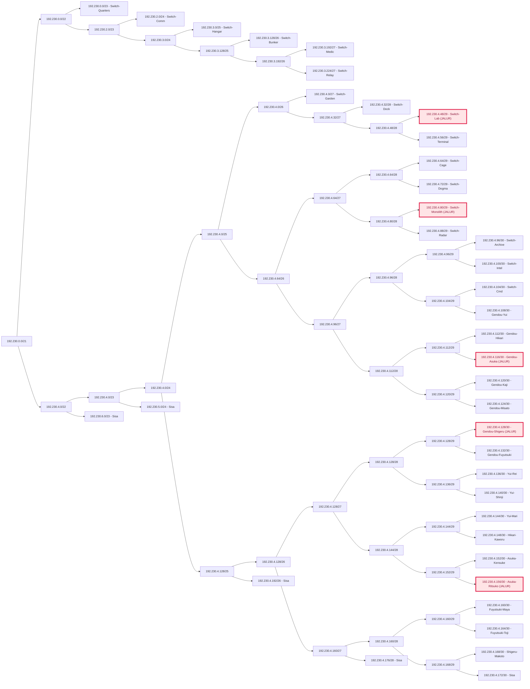

# Jarkom-Modul-5-2026-K-38

**Kelompok:** K-38  

### Anggota 
| Nama | NRP | Soal |
|---|---|---|
| Farrel Arteya Kumara | 5027251020 | 1-10 |
| Nayla Arsha Adyuta | 5027251042 | 11-20 |

<br/>


<br/>

Topologi **Operation Geofront** terdiri dari **17 Router**, **17 Ethernet Switch**, **1 NAT1**, dan **25 Node Host/Server** (total **42 container Docker**):

- **`debinet` (22 node):**
  - Seluruh **17 Router**: `Gendou`, `Yui`, `Hikari`, `Asuka`, `Kaji`, `Misato`, `Shigeru`, `Fuyutsuki`, `Rei`, `Shinji`, `Mari`, `Kaworu`, `Kensuke`, `Ritsuko`, `Makoto`, `Maya`, `Toji`.
  - **5 Server Layanan Aktif**: `Magi-Casper`, `Magi-Balthasar`, `Magi-Melchior`, `Pen-Pen`, `Tokyo3-Core` *(membutuhkan `apt`, `iptables`, `netcat-traditional`, dan `ifupdown`)*.
- **`alpinet` (20 node):**
  - Seluruh **16 Node Client** (`Quarters`, `Dock-Crew`, `Garden-Staff`, `Hangar-Crew`, `Sachiel`, `Entry-Plug`, `Dummy-Plug`, `Spy`, `Unit-01`, `Unit-02`, `Unit-00`, `Lilith`, `Adam`, `Zeruel`, `Armisael`, `Medic-Bay`) serta **4 Node Pasif** (`Comm-Net`, `Relay-Node`, `Archive-Vault`, `Radar-Array`).

<br/>

# Babak 1: Membangun Geofront

## Soal 1: Markas Tanpa Peta (VLSM & Pohon IP)
Markas tanpa peta: tengah malam alarm meraung, dan Ritsuko terdiam. Markas sebesar ini dibangun tanpa peta alamat. Gendo anti pemborosan, jadi tiap subnet memakai prefix terkecil yang muat. Bagi prefix IP kelompokmu dengan VLSM untuk 17 LAN dan 16 link antar-router, urut dari kebutuhan terbesar. Tunjukkan tabel berisi network, prefix, gateway, broadcast, IP terpakai, dan sisa. Tunjukkan juga gambar pohon IP, dengan subnet jalur Dummy-Plug ke Armisael dilingkari. Di laporan, jelaskan hitungan satu subnet.

### Aturan Perhitungan VLSM
1. Setiap LAN membutuhkan `(Jumlah Host) + 1 (Gateway)` alamat usable, atau total `(Jumlah Host) + 3` alamat termasuk Network ID dan Broadcast Address.
2. Pembagian diurutkan dari ukuran blok terbesar (`/23` hingga `/30`).
3. **Tie-break:** Jika ukuran subnet sama, **LAN didahulukan sebelum link antar-router**, lalu mengikuti **urutan Tabel Host**.
4. Untuk 16 link antar-router (`/30`), 7 link langsung milik `Gendou` diletakkan terlebih dahulu (`4.108/30` – `4.132/30`), dilanjutkan 9 link cabang yang dikelompokkan per router induk pada batas `/29` agar menghasilkan **CIDR summarization optimal** pada Soal 3.

### Tabel Pembagian IP VLSM (17 LAN + 16 Link Antar-Router)

| No | Segmen / Link | Router Gateway / Ujung | Kebutuhan (Host+GW) | Network | Prefix | Gateway / IP Router | Broadcast | IP Terpakai | Sisa Usable |
|---:|---|---|---:|---|---|---|---:|---:|---:|
| 1 | Switch-Quarters | Rei | 501 | `192.230.0.0` | `/23` | `192.230.0.1` | `192.230.1.255` | 501 | 9 |
| 2 | Switch-Comm | Hikari | 201 | `192.230.2.0` | `/24` | `192.230.2.1` | `192.230.2.255` | 201 | 53 |
| 3 | Switch-Hangar | Yui | 101 | `192.230.3.0` | `/25` | `192.230.3.1` | `192.230.3.127` | 101 | 25 |
| 4 | Switch-Bunker | Kensuke | 56 | `192.230.3.128` | `/26` | `192.230.3.129` | `192.230.3.191` | 56 | 6 |
| 5 | Switch-Medic | Maya | 27 | `192.230.3.192` | `/27` | `192.230.3.193` | `192.230.3.223` | 27 | 3 |
| 6 | Switch-Relay | Kaworu | 26 | `192.230.3.224` | `/27` | `192.230.3.225` | `192.230.3.255` | 26 | 4 |
| 7 | Switch-Garden | Shinji | 15 | `192.230.4.0` | `/27` | `192.230.4.1` | `192.230.4.31` | 15 | 15 |
| 8 | Switch-Dock | Mari | 13 | `192.230.4.32` | `/28` | `192.230.4.33` | `192.230.4.47` | 13 | 1 |
| 9 | **Switch-Lab** *(jalur)* | Ritsuko | 6 | `192.230.4.48` | `/29` | `192.230.4.49` | `192.230.4.55` | 6 | 0 |
| 10 | Switch-Terminal | Fuyutsuki | 4 | `192.230.4.56` | `/29` | `192.230.4.57` | `192.230.4.63` | 4 | 2 |
| 11 | Switch-Cage | Misato | 4 | `192.230.4.64` | `/29` | `192.230.4.65` | `192.230.4.71` | 4 | 2 |
| 12 | Switch-Dogma | Toji | 3 | `192.230.4.72` | `/29` | `192.230.4.73` | `192.230.4.79` | 3 | 3 |
| 13 | **Switch-Monolith** *(jalur)* | Shigeru | 3 | `192.230.4.80` | `/29` | `192.230.4.81` | `192.230.4.87` | 3 | 3 |
| 14 | Switch-Radar | Makoto | 5 | `192.230.4.88` | `/29` | `192.230.4.89` | `192.230.4.95` | 5 | 1 |
| 15 | Switch-Archive | Asuka | 2 | `192.230.4.96` | `/30` | `192.230.4.97` | `192.230.4.99` | 2 | 0 |
| 16 | Switch-Intel | Kaji | 2 | `192.230.4.100` | `/30` | `192.230.4.101` | `192.230.4.103` | 2 | 0 |
| 17 | Switch-Cmd | Gendou | 2 | `192.230.4.104` | `/30` | `192.230.4.105` | `192.230.4.107` | 2 | 0 |
| 18 | Link Gendou–Yui | Gendou / Yui | 2 | `192.230.4.108` | `/30` | `.109` / `.110` | `192.230.4.111` | 2 | 0 |
| 19 | Link Gendou–Hikari | Gendou / Hikari | 2 | `192.230.4.112` | `/30` | `.113` / `.114` | `192.230.4.115` | 2 | 0 |
| 20 | **Link Gendou–Asuka** *(jalur)* | Gendou / Asuka | 2 | `192.230.4.116` | `/30` | `.117` / `.118` | `192.230.4.119` | 2 | 0 |
| 21 | Link Gendou–Kaji | Gendou / Kaji | 2 | `192.230.4.120` | `/30` | `.121` / `.122` | `192.230.4.123` | 2 | 0 |
| 22 | Link Gendou–Misato | Gendou / Misato | 2 | `192.230.4.124` | `/30` | `.125` / `.126` | `192.230.4.127` | 2 | 0 |
| 23 | **Link Gendou–Shigeru** *(jalur)* | Gendou / Shigeru | 2 | `192.230.4.128` | `/30` | `.129` / `.130` | `192.230.4.131` | 2 | 0 |
| 24 | Link Gendou–Fuyutsuki | Gendou / Fuyutsuki | 2 | `192.230.4.132` | `/30` | `.133` / `.134` | `192.230.4.135` | 2 | 0 |
| 25 | Link Yui–Rei | Yui / Rei | 2 | `192.230.4.136` | `/30` | `.137` / `.138` | `192.230.4.139` | 2 | 0 |
| 26 | Link Yui–Shinji | Yui / Shinji | 2 | `192.230.4.140` | `/30` | `.141` / `.142` | `192.230.4.143` | 2 | 0 |
| 27 | Link Yui–Mari | Yui / Mari | 2 | `192.230.4.144` | `/30` | `.145` / `.146` | `192.230.4.147` | 2 | 0 |
| 28 | Link Hikari–Kaworu | Hikari / Kaworu | 2 | `192.230.4.148` | `/30` | `.149` / `.150` | `192.230.4.151` | 2 | 0 |
| 29 | Link Asuka–Kensuke | Asuka / Kensuke | 2 | `192.230.4.152` | `/30` | `.153` / `.154` | `192.230.4.155` | 2 | 0 |
| 30 | **Link Asuka–Ritsuko** *(jalur)* | Asuka / Ritsuko | 2 | `192.230.4.156` | `/30` | `.157` / `.158` | `192.230.4.159` | 2 | 0 |
| 31 | Link Fuyutsuki–Maya | Fuyutsuki / Maya | 2 | `192.230.4.160` | `/30` | `.161` / `.162` | `192.230.4.163` | 2 | 0 |
| 32 | Link Fuyutsuki–Toji | Fuyutsuki / Toji | 2 | `192.230.4.164` | `/30` | `.165` / `.166` | `192.230.4.167` | 2 | 0 |
| 33 | Link Shigeru–Makoto | Shigeru / Makoto | 2 | `192.230.4.168` | `/30` | `.169` / `.170` | `192.230.4.171` | 2 | 0 |

### Perhitungan 1 Subnet (`Switch-Garden` — Gateway `Shinji`)
1. **Kebutuhan alamat:** `Garden-Staff` membutuhkan 14 host + 1 alamat untuk router gateway (`Shinji`) = **15 alamat usable**. Ditambah 1 Network ID dan 1 Broadcast Address → total minimal **17 alamat**.
2. **Menentukan bit host ($h$):** Dicari bilangan bulat terkecil $h$ sehingga $2^h - 2 \ge 15$:
   - Jika $h = 4$: $2^4 - 2 = 14 < 15$ *(tidak mencukupi)*.
   - Jika $h = 5$: $2^5 - 2 = 30 \ge 15$ *(mencukupi, ukuran blok = $2^5 = 32$ alamat)*.
3. **Menentukan prefix dan subnet mask:**
   $$\text{Prefix} = 32 - 5 = /27 \quad (\text{Netmask: } 255.255.255.224)$$
4. **Menentukan rentang alamat:** Karena subnet sebelumnya (`Switch-Relay`) berakhir di `192.230.3.255`, maka `Switch-Garden` dimulai pada alamat berikutnya yang merupakan kelipatan 32:
   - **Network ID:** `192.230.4.0/27`
   - **Gateway (usable ke-1, `Shinji eth1`):** `192.230.4.1`
   - **Host `Garden-Staff` (usable ke-2):** `192.230.4.2`
   - **Broadcast Address:** `192.230.4.31` (`4.0 + 32 - 1`)
   - **IP Terpakai:** `15` (14 host + 1 gateway), **Sisa Usable:** `30 - 15 = 15`.

### Pohon Pembagian IP & Subnet Jalur `Dummy-Plug` → `Armisael`

Jalur paket dari **`Dummy-Plug`** (`192.230.4.51`) menuju **`Armisael`** (`192.230.4.83`) melewati **5 subnet** (ditandai merah / dilingkari pada pohon IP):
1. **`192.230.4.48/29`** — `Switch-Lab` (LAN asal `Dummy-Plug`)
2. **`192.230.4.156/30`** — `Link Asuka–Ritsuko`
3. **`192.230.4.116/30`** — `Link Gendou–Asuka`
4. **`192.230.4.128/30`** — `Link Gendou–Shigeru`
5. **`192.230.4.80/29`** — `Switch-Monolith` (LAN tujuan `Armisael`)



<br/>

## Soal 2: Geofront Gelap Gulita (Topologi, IP Router & IP Forwarding)
Geofront gelap gulita: kabel sudah ditarik, tapi saat Misato menekan tombol daya, Geofront tetap gelap. Tidak ada alamat dan tidak ada rute. Pasang semua node di GNS3 sesuai topologi. Beri IP ke tiap interface router sesuai soal 1, lalu aktifkan IP forwarding di semua router. Hanya Gendo yang terhubung ke NAT1 dan mendapat alamat lewat DHCP. Router lain baru bisa memasang paket setelah soal 4, karena internet baru ada saat itu. Tunjukkan ip -br di tiap router dan ping dua ujung tiap link router ke router.

| Router | Adapter | Pemetaan Interface & Alamat IP |
|---|---:|---|
| **Gendou** | 9 | `eth0`→NAT1 (DHCP), `eth1`→`192.230.4.105/30`, `eth2`→`192.230.4.109/30`, `eth3`→`192.230.4.113/30`, `eth4`→`192.230.4.117/30`, `eth5`→`192.230.4.121/30`, `eth6`→`192.230.4.125/30`, `eth7`→`192.230.4.129/30`, `eth8`→`192.230.4.133/30` |
| **Yui** | 5 | `eth0`→`192.230.4.110/30`, `eth1`→`192.230.3.1/25`, `eth2`→`192.230.4.137/30`, `eth3`→`192.230.4.141/30`, `eth4`→`192.230.4.145/30` |
| **Hikari** | 3 | `eth0`→`192.230.4.114/30`, `eth1`→`192.230.2.1/24`, `eth2`→`192.230.4.149/30` |
| **Asuka** | 4 | `eth0`→`192.230.4.118/30`, `eth1`→`192.230.4.97/30`, `eth2`→`192.230.4.153/30`, `eth3`→`192.230.4.157/30` |
| **Kaji** | 2 | `eth0`→`192.230.4.122/30`, `eth1`→`192.230.4.101/30` |
| **Misato** | 2 | `eth0`→`192.230.4.126/30`, `eth1`→`192.230.4.65/29` |
| **Shigeru** | 3 | `eth0`→`192.230.4.130/30`, `eth1`→`192.230.4.81/29`, `eth2`→`192.230.4.169/30` |
| **Fuyutsuki** | 4 | `eth0`→`192.230.4.134/30`, `eth1`→`192.230.4.57/29`, `eth2`→`192.230.4.161/30`, `eth3`→`192.230.4.165/30` |
| **Rei** | 2 | `eth0`→`192.230.4.138/30`, `eth1`→`192.230.0.1/23` |
| **Shinji** | 2 | `eth0`→`192.230.4.142/30`, `eth1`→`192.230.4.1/27` |
| **Mari** | 2 | `eth0`→`192.230.4.146/30`, `eth1`→`192.230.4.33/28` |
| **Kaworu** | 2 | `eth0`→`192.230.4.150/30`, `eth1`→`192.230.3.225/27` |
| **Kensuke** | 2 | `eth0`→`192.230.4.154/30`, `eth1`→`192.230.3.129/26` |
| **Ritsuko** | 2 | `eth0`→`192.230.4.158/30`, `eth1`→`192.230.4.49/29` |
| **Makoto** | 2 | `eth0`→`192.230.4.170/30`, `eth1`→`192.230.4.89/29` |
| **Maya** | 2 | `eth0`→`192.230.4.162/30`, `eth1`→`192.230.3.193/27` |
| **Toji** | 2 | `eth0`→`192.230.4.166/30`, `eth1`→`192.230.4.73/29` |

### Verifikasi
Setiap router diverifikasi dengan `ip -br a`, `sysctl net.ipv4.ip_forward` (`= 1`), dan uji ping pada dua ujung seluruh 16 link router-ke-router:

- **`ip -br a` dan `sysctl net.ipv4.ip_forward` pada `Gendou`** (`eth0` mendapat IP DHCP dari NAT1 `192.168.122.61/24`, `eth1`–`eth8` aktif sesuai Soal 1, dan `net.ipv4.ip_forward = 1`):


- **Uji ping antar-ujung link router-ke-router dari `Gendou`** menuju seluruh 7 router cabang langsung (`.110`, `.114`, `.118`, `.122`, `.126`, `.130`, `.134` — **0% packet loss**):


<br/>

## Soal 3: Pulau-Pulau yang Terpisah (Static Routing & CIDR Summarization)
Pulau-pulau yang terpisah: lampu mulai menyala, tapi tiap segmen masih seperti pulau terpisah. Fuyutsuki mengingatkan: bangun jalur dari Gendo ke bawah, cabang demi cabang. Hubungkan semua subnet dengan routing statis dan jumlah rute sesedikit mungkin. Router selain Gendo cukup punya satu default route ke atas dan rute untuk subnet di bawahnya. Gendo memakai default route ke NAT1. Subnet satu cabang yang bisa digabung tepat menjadi satu CIDR harus diringkas. Untuk soal 3 sampai 5, beri IP dan gateway sementara pada node uji. IP permanen dibuat di soal 6. Buktikan Armisael bisa ping ke Lilith, Sachiel, dan Comm-Net.

### Ringkasan Rute (CIDR Summarization) di `Gendou`
Seluruh 16 router bawahan cukup memiliki **1 default route ke atas** ditambah rute spesifik ke subnet di bawahnya. Pada `Gendou`, 4 pasang subnet yang berada pada cabang yang sama dan bersebelahan pada batas bit CIDR diringkas tepat menjadi satu rute, sehingga dari 25 subnet bawahan hanya dibutuhkan **21 static route** (+ 1 default route DHCP ke NAT1):

| Cabang | Subnet yang Digabung | CIDR Ringkasan | Next-Hop |
|---|---|---|---|
| **Shigeru** | `192.230.4.80/29` (Switch-Monolith) + `192.230.4.88/29` (Switch-Radar) | **`192.230.4.80/28`** | `192.230.4.130` |
| **Yui** | `192.230.4.136/30` (Yui–Rei) + `192.230.4.140/30` (Yui–Shinji) | **`192.230.4.136/29`** | `192.230.4.110` |
| **Asuka** | `192.230.4.152/30` (Asuka–Kensuke) + `192.230.4.156/30` (Asuka–Ritsuko) | **`192.230.4.152/29`** | `192.230.4.118` |
| **Fuyutsuki** | `192.230.4.160/30` (Fuyutsuki–Maya) + `192.230.4.164/30` (Fuyutsuki–Toji) | **`192.230.4.160/29`** | `192.230.4.134` |

### Rute Statis per Router (`<nama>.sh`)
- **`Gendou`:** 21 rute `ip route replace` (4 CIDR summary + 17 subnet lainnya) menuju 7 router cabang + `default` via `NAT1`.
- **`Yui`:** `default via 192.230.4.109`, `192.230.0.0/23 via .4.138`, `192.230.4.0/27 via .4.142`, `192.230.4.32/28 via .4.146`.
- **`Hikari`:** `default via 192.230.4.113`, `192.230.3.224/27 via .4.150`.
- **`Asuka`:** `default via 192.230.4.117`, `192.230.3.128/26 via .4.154`, `192.230.4.48/29 via .4.158`.
- **`Shigeru`:** `default via 192.230.4.129`, `192.230.4.88/29 via .4.170`.
- **`Fuyutsuki`:** `default via 192.230.4.133`, `192.230.3.192/27 via .4.162`, `192.230.4.72/29 via .4.166`.
- **11 Router Leaf** (`Kaji`, `Misato`, `Rei`, `Shinji`, `Mari`, `Kaworu`, `Kensuke`, `Ritsuko`, `Makoto`, `Maya`, `Toji`): masing-masing cukup 1 `default route` ke router induknya.

### Pengujian Soal 3
Pengujian dilakukan dari **`Armisael`** (`192.230.4.83`) menuju **`Lilith`** (`192.230.4.74`), **`Sachiel`** (`192.230.3.130`), dan **`Comm-Net`** (`192.230.2.2`). Ketiganya berhasil dengan **0% packet loss**:


<br/>

## Soal 4: Haus Kabar dari Dunia Luar (NAT Masquerade & DNS)
Haus kabar dari dunia luar: Maya melapor bahwa semua sistem butuh update dari luar, padahal pintu keluarnya hanya Gendo. IP dari NAT1 juga bisa berganti kapan saja. Beri seluruh jaringan akses internet lewat Gendo. Konfigurasinya tidak boleh perlu diubah saat IP NAT1 berganti. Hanya traffic dari prefix internal yang keluar lewat NAT1 yang boleh diterjemahkan alamatnya, sedangkan traffic antar-LAN harus tetap membawa alamat asli pengirimnya. Node yang nanti memasang paket juga harus bisa me-resolve nama domain. Selesaikan sebelum node lain memasang paket. Buktikan ping 8.8.8.8 dan ping deb.debian.org dari Armisael dan Lilith berhasil, dan tunjukkan counter rule NAT.

### Konfigurasi di `Gendou`
Agar seluruh jaringan internal dapat mengakses internet melalui `Gendou` tanpa perlu mengubah rule saat IP DHCP `NAT1` berubah, digunakan target **`MASQUERADE`** yang dibatasi hanya untuk prefix internal keluar lewat interface `eth0`:

```bash
echo "nameserver 8.8.8.8" > /etc/resolv.conf
apt update && apt install -y ifupdown iptables conntrack
iptables -t nat -A POSTROUTING -s 192.230.0.0/16 -o eth0 -j MASQUERADE
```

- **`-j MASQUERADE`**: secara dinamis mengikuti IP `eth0` dari DHCP `NAT1`.
- **`-s 192.230.0.0/16 -o eth0`**: hanya menerjemahkan paket dari prefix internal yang keluar menuju `NAT1`; lalu lintas antar-LAN keluar lewat `eth1`–`eth8` sehingga mempertahankan alamat IP asli pengirim.
- **DNS Resolver**: diatur `nameserver 8.8.8.8` di `/etc/resolv.conf` agar seluruh node dapat me-resolve nama domain seperti `deb.debian.org`.

### Bukti Pengujian Soal 4
- **`Armisael`** berhasil `ping 8.8.8.8` (**0% packet loss**):


**`Lilith`** berhasil `ping 8.8.8.8` (**0% packet loss**):


**Counter rule NAT `MASQUERADE` di `Gendou`** (`iptables -t nat -L POSTROUTING -n -v`) naik menjadi `33 pkts, 2262 bytes`:


<br/>

## Soal 5: Pintu Depan Dikunci Rapat (Stateful Firewall Gendou)
Pintu depan dikunci rapat: Kaji memperingatkan Kaworu bahwa SEELE cukup mengetuk pintu depan. Gendo mengunci NAT1: boleh keluar, tidak boleh dimasuki. Di Gendo, ubah policy INPUT dan FORWARD menjadi DROP. Lalu izinkan empat hal: (a) balasan koneksi yang sudah ada, (b) traffic dari jaringan internal ke internet, (c) traffic antar-LAN, dan (d) traffic dari jaringan internal ke Gendo sendiri. Loopback dan DHCP dari NAT1 juga harus tetap jalan. Koneksi baru dari sisi NAT1 tidak boleh masuk. Soal 2 sampai 4 harus tetap jalan, dan semuanya ditulis di gendo.sh. Tunjukkan iptables -S di Gendo, dan buktikan ping 8.8.8.8 dari Armisael masih berhasil.

```bash
#!/bin/bash
set -e

INTERNAL_NET="192.230.0.0/16"
WAN_IF="eth0"

sysctl -w net.ipv4.ip_forward=1
echo "nameserver 8.8.8.8" > /etc/resolv.conf

# Static Routing (Soal 3)
ip route replace 192.230.0.0/23   via 192.230.4.110
ip route replace 192.230.3.0/25   via 192.230.4.110
ip route replace 192.230.4.0/27   via 192.230.4.110
ip route replace 192.230.4.32/28  via 192.230.4.110
ip route replace 192.230.4.136/29 via 192.230.4.110
ip route replace 192.230.4.144/30 via 192.230.4.110
ip route replace 192.230.2.0/24   via 192.230.4.114
ip route replace 192.230.3.224/27 via 192.230.4.114
ip route replace 192.230.4.148/30 via 192.230.4.114
ip route replace 192.230.3.128/26 via 192.230.4.118
ip route replace 192.230.4.48/29  via 192.230.4.118
ip route replace 192.230.4.96/30  via 192.230.4.118
ip route replace 192.230.4.152/29 via 192.230.4.118
ip route replace 192.230.4.100/30 via 192.230.4.122
ip route replace 192.230.4.64/29  via 192.230.4.126
ip route replace 192.230.4.80/28  via 192.230.4.130
ip route replace 192.230.4.168/30 via 192.230.4.130
ip route replace 192.230.3.192/27 via 192.230.4.134
ip route replace 192.230.4.56/29  via 192.230.4.134
ip route replace 192.230.4.72/29  via 192.230.4.134
ip route replace 192.230.4.160/29 via 192.230.4.134

# Reset aman iptables
iptables -P INPUT ACCEPT
iptables -P FORWARD ACCEPT
iptables -P OUTPUT ACCEPT
iptables -F && iptables -X
iptables -t nat -F && iptables -t nat -X

# INPUT: loopback, (a) ESTABLISHED/RELATED, DHCP NAT1, (d) internal ke Gendou
iptables -A INPUT -i lo -j ACCEPT
iptables -A INPUT -m conntrack --ctstate ESTABLISHED,RELATED -j ACCEPT
iptables -A INPUT -i "$WAN_IF" -p udp --sport 67 --dport 68 -j ACCEPT
iptables -A INPUT ! -i "$WAN_IF" -s "$INTERNAL_NET" -j ACCEPT

# FORWARD: (a) ESTABLISHED/RELATED, (b) internal ke internet, (c) antar-LAN
iptables -A FORWARD -m conntrack --ctstate ESTABLISHED,RELATED -j ACCEPT
iptables -A FORWARD ! -i "$WAN_IF" -o "$WAN_IF" -s "$INTERNAL_NET" -j ACCEPT
iptables -A FORWARD ! -i "$WAN_IF" ! -o "$WAN_IF" -s "$INTERNAL_NET" -d "$INTERNAL_NET" -j ACCEPT

# Policy INPUT & FORWARD = DROP (koneksi baru dari NAT1 otomatis ditolak)
iptables -P INPUT DROP
iptables -P FORWARD DROP
iptables -P OUTPUT ACCEPT

# NAT Masquerade (Soal 4)
iptables -t nat -A POSTROUTING -s "$INTERNAL_NET" -o "$WAN_IF" -j MASQUERADE
```

### Pengujian Soal 5
Setelah firewall `DROP` diaktifkan pada `Gendou`, pengujian `ping 8.8.8.8` dan `ping 192.230.4.74` (`Lilith`) dari `Armisael` tetap berhasil **0% packet loss**:


<br/>

## Soal 6: Alamat Para Pilot (IP Statis Permanen Non-Router)
Alamat para pilot: jaringan sudah hidup, tapi para pilot dan staf tidak tahu alamat mereka sendiri. Unit-01 bahkan tidak tahu siapa gateway-nya. Beri IP statis dan gateway ke semua node non-router, sesuai aturan alamat di glosarium. Simpan agar bertahan setelah restart. Tunjukkan ip -br dan ping ke gateway di Unit-01.

Seluruh **25 node non-router** diberi IP statis dan gateway permanen melalui `/etc/network/interfaces` sesuai aturan urutan Glosarium (gateway = usable ke-1, host = usable berikutnya kiri ke kanan):

| Switch | Node | Image | IP Address | Netmask | Gateway |
|---|---|---|---|---|---|
| Switch-Quarters | `Quarters` | `alpinet` | `192.230.0.2` | `255.255.254.0` | `192.230.0.1` |
| Switch-Comm | `Comm-Net` | `alpinet` | `192.230.2.2` | `255.255.255.0` | `192.230.2.1` |
| Switch-Hangar | `Hangar-Crew` | `alpinet` | `192.230.3.2` | `255.255.255.128` | `192.230.3.1` |
| Switch-Bunker | `Sachiel` | `alpinet` | `192.230.3.130` | `255.255.255.192` | `192.230.3.129` |
| Switch-Medic | `Pen-Pen` | `debinet` | `192.230.3.194` | `255.255.255.224` | `192.230.3.193` |
| Switch-Medic | `Medic-Bay` | `alpinet` | `192.230.3.195` | `255.255.255.224` | `192.230.3.193` |
| Switch-Relay | `Relay-Node` | `alpinet` | `192.230.3.226` | `255.255.255.224` | `192.230.3.225` |
| Switch-Garden | `Garden-Staff` | `alpinet` | `192.230.4.2` | `255.255.255.224` | `192.230.4.1` |
| Switch-Dock | `Dock-Crew` | `alpinet` | `192.230.4.34` | `255.255.255.240` | `192.230.4.33` |
| Switch-Lab | `Entry-Plug` | `alpinet` | `192.230.4.50` | `255.255.255.248` | `192.230.4.49` |
| Switch-Lab | `Dummy-Plug` | `alpinet` | `192.230.4.51` | `255.255.255.248` | `192.230.4.49` |
| Switch-Terminal | `Magi-Casper` | `debinet` | `192.230.4.58` | `255.255.255.248` | `192.230.4.57` |
| Switch-Terminal | `Magi-Balthasar` | `debinet` | `192.230.4.59` | `255.255.255.248` | `192.230.4.57` |
| Switch-Terminal | `Magi-Melchior` | `debinet` | `192.230.4.60` | `255.255.255.248` | `192.230.4.57` |
| Switch-Cage | `Unit-01` | `alpinet` | `192.230.4.66` | `255.255.255.248` | `192.230.4.65` |
| Switch-Cage | `Unit-02` | `alpinet` | `192.230.4.67` | `255.255.255.248` | `192.230.4.65` |
| Switch-Cage | `Unit-00` | `alpinet` | `192.230.4.68` | `255.255.255.248` | `192.230.4.65` |
| Switch-Dogma | `Lilith` | `alpinet` | `192.230.4.74` | `255.255.255.248` | `192.230.4.73` |
| Switch-Dogma | `Adam` | `alpinet` | `192.230.4.75` | `255.255.255.248` | `192.230.4.73` |
| Switch-Monolith | `Zeruel` | `alpinet` | `192.230.4.82` | `255.255.255.248` | `192.230.4.81` |
| Switch-Monolith | `Armisael` | `alpinet` | `192.230.4.83` | `255.255.255.248` | `192.230.4.81` |
| Switch-Radar | `Radar-Array` | `alpinet` | `192.230.4.90` | `255.255.255.248` | `192.230.4.89` |
| Switch-Archive | `Archive-Vault` | `alpinet` | `192.230.4.98` | `255.255.255.252` | `192.230.4.97` |
| Switch-Intel | `Spy` | `alpinet` | `192.230.4.102` | `255.255.255.252` | `192.230.4.101` |
| Switch-Cmd | `Tokyo3-Core` | `debinet` | `192.230.4.106` | `255.255.255.252` | `192.230.4.105` |

### Pengujian Soal 6 (`Unit-01` Setelah Restart)
`ip -br a` menampilkan `192.230.4.66/29` pada `eth0` dan `ping` ke gateway `Misato` (`192.230.4.65`) berhasil **0% packet loss**:


<br/>

## Soal 7: Membangunkan MAGI
Membangunkan MAGI: Casper, Balthasar, dan Melchior di Switch-Terminal menunggu diaktifkan. Ritsuko ingin ketiganya melayani dulu, urusan keamanan dibahas nanti. Pasang iptables dan netcat-traditional lewat /root/<nama>.sh, lalu nyalakan listener sesuai port di glosarium. Dari Lilith, kirim pesan ke ketiganya dan ke port 5001 Balthasar. Tampilkan pesan yang diterima di tiap node.

Pada `Magi-Casper` (`192.230.4.58`), `Magi-Balthasar` (`192.230.4.59`), dan `Magi-Melchior` (`192.230.4.60`), dipasang `ifupdown`, `iptables`, dan `netcat-traditional` melalui `<nama>.sh`, lalu dijalankan listener `nc.traditional` sesuai port Glosarium (`Casper`: `5000`, `Balthasar`: `5000` & `5001`, `Melchior`: `5000`).

Script `magi-balthasar.sh`

```bash
#!/bin/bash
echo "nameserver 8.8.8.8" > /etc/resolv.conf
rm -f /etc/apt/sources.list /etc/apt/sources.list.d/*.list /etc/apt/sources.list.d/*.sources
cat << 'REPO' > /etc/apt/sources.list.d/debian.sources
Types: deb
URIs: http://deb.debian.org/debian
Suites: trixie trixie-updates
Components: main
Signed-By: /usr/share/keyrings/debian-archive-keyring.gpg
REPO
which nc.traditional >/dev/null 2>&1 || (apt-get update && apt-get install -y ifupdown iptables netcat-traditional)

pkill -f "nc.traditional -l -p 5000" 2>/dev/null || true
pkill -f "nc.traditional -l -p 5001" 2>/dev/null || true
nohup bash -c 'while true; do nc.traditional -l -p 5000; done' >> /tmp/balthasar_5000.txt 2>&1 &
nohup bash -c 'while true; do nc.traditional -l -p 5001; done' >> /tmp/balthasar_5001.txt 2>&1 &
```

### Pengujian Soal 7
Pengiriman pesan dari `Lilith` ke ketiga node MAGI dan port `5001` Balthasar seluruhnya selesai dengan **`exit=0`**:


<br/>

## Soal 8: Mengenali Kondisi Normal (`Pen-Pen` & `Tokyo3-Core`)
Mengenali kondisi normal: Pen-Pen dan Tokyo3-Core sudah ditandai sebagai calon sasaran pertama SEELE. Sebelum dilindungi, keduanya harus melayani dulu agar kamu tahu kondisi normalnya. Koneksi ke port 80 dijawab Welcome to {hostname}. Koneksi ke port 8080 di Tokyo3-Core dijawab syifa imutz. Tunjukkan nc dari Lilith ke ketiga port itu. Tunjukkan juga bahwa port yang tidak dilayani, misalnya 22, langsung gagal, bukan menggantung.

### Pengujian Soal 8
Pengujian dari **`Lilith`** ke ketiga port layanan berhasil (`Welcome to Pen-Pen`, `Welcome to Tokyo3-Core`, `syifa imutz` dengan `exit=0`), sedangkan koneksi ke port `22` langsung gagal seketika (`real 0m0.004s` dan `0m0.003s`, `exit=1`):


<br/>

# Babak 2: Sabotase dan Hantu MAGI

## Soal 9: Jalur Belakang Diutak-atik (`break_routing.sh` di `Shigeru`)
Jalur belakang diutak-atik: tengah malam masuk laporan bahwa ada yang mengutak-atik jalur belakang di sekitar Shigeru. Lilith tidak mendapat jawaban dari Armisael, padahal Armisael masih bisa ping gateway-nya sendiri. Jalankan break_routing.sh di Shigeru. Buktikan Lilith bisa ping Armisael kembali setelah perbaikan.

### 1. Eksekusi Sabotase & Verifikasi Gejala
Script `break_routing.sh` dijalankan langsung di **`Shigeru`** tanpa membaca isinya:


Gejala yang muncul sesuai skenario soal:
**`Armisael` masih bisa ping gateway-nya sendiri (`Shigeru` `192.230.4.81`)** dengan 0% packet loss:


**`Lilith` (`192.230.4.74`) gagal ping ke `Armisael` (`192.230.4.83`)** dengan 100% packet loss:


### 2. Hasil Diagnostik di `Shigeru` & Temuan 4 Penyebab Sabotase
Pemeriksaan dilakukan dengan `sysctl net.ipv4.ip_forward`, `ip -br a`, `ip route show`, `ip rule show`, `iptables -S`, dan `ping 192.230.4.129`:


Ditemukan **4 penyebab sekaligus** pada `Shigeru`:
1. **`net.ipv4.ip_forward = 0`** — Fitur forwarding kernel dimatikan sehingga `Shigeru` tidak meneruskan paket lintas interface (`eth0` ↔ `eth1`).
2. **`default via 192.230.4.170 dev eth2`** — Default route dibelokkan ke router bawahan **`Makoto`** (`192.230.4.170` via `eth2`), bukan ke **`Gendou`** (`192.230.4.129` via `eth0`), sehingga menimbulkan *routing loop* `Shigeru ↔ Makoto`.
3. **`blackhole 192.230.4.72/29`** — Ditanam rute `blackhole` khusus ke subnet `Switch-Dogma` (`Lilith`), sehingga paket balasan ke `Lilith` langsung dibuang diam-diam.
4. **`90: from all iif eth1 lookup 100`** — Ditambahkan aturan *policy routing* (`ip rule`) berprioritas `90` yang mengalihkan seluruh paket masuk dari `eth1` (`Switch-Monolith`) ke tabel routing `100` sebelum mencapai tabel `main`.

### 3. Perbaikan & Pembuktian
Seluruh penyebab dibersihkan (`ip rule del pref 90`, `ip route del blackhole 192.230.4.72/29`, mengaktifkan `net.ipv4.ip_forward = 1`, dan memulihkan `default via 192.230.4.129 dev eth0` melalui `shigeru.sh`):


Setelah perbaikan, `ping` dari **`Lilith`** ke **`Armisael`** (`192.230.4.83`) kembali berhasil dengan **0% packet loss**:


---

## Soal 10: Para Pilot Terkunci di Dalam (`break_nat.sh` di `Misato` & `Gendou`)
Para pilot terkunci di dalam: paginya giliran para pilot mengeluh. Unit-01, Unit-02, dan Unit-00 di Cage tidak bisa ping 8.8.8.8. Padahal Spy di Intel baik-baik saja, dan ping dari Cage ke Lilith normal. Jalankan break_nat.sh di Misato dan di Gendo. Filenya sama, dijalankan di masing-masing node. Jelaskan kenapa Cage terdampak tapi Intel tidak. Buktikan Unit-01 bisa ping 8.8.8.8, dan sebutkan di router mana alamat sumber diterjemahkan.

### 1. Verifikasi Gejala Setelah Menjalankan `break_nat.sh`
Setelah `break_nat.sh` dijalankan pada `Misato` dan `Gendou`:
- Di **`Unit-01`** (`Switch-Cage`): `ping 8.8.8.8` **gagal (100% packet loss)**, sedangkan `ping 192.230.4.74` (`Lilith`) **normal (0% packet loss)**:


- Di **`Spy`** (`Switch-Intel`): `ping 8.8.8.8` **tetap berhasil (0% packet loss)**:


### 2. Hasil Diagnostik di `Misato` dan `Gendou` & Temuan 2 Penyebab Sabotase

**Diagnostik di `Misato`:**


Ditemukan **Penyebab #1 (di `Misato`)**:
```text
-A POSTROUTING -s 192.230.4.64/29 ! -d 192.230.0.0/16 -o eth0 -j SNAT --to-source 172.31.99.1
```
Router internal `Misato` melakukan **`SNAT`** mengubah IP sumber paket dari `Switch-Cage` (`192.230.4.64/29`) yang menuju keluar prefix internal (`! -d 192.230.0.0/16`, termasuk `8.8.8.8`) menjadi **`172.31.99.1`** (terbukti counter `1 pkts, 84 bytes`).

**Diagnostik di `Gendou`:**


Ditemukan **Penyebab #2 (di `Gendou`)**:
```text
-A POSTROUTING -s 192.230.4.64/29 -o eth0 -j RETURN
-A POSTROUTING -s 192.230.0.0/16 -o eth0 -j MASQUERADE
```
Pada tabel `nat` `Gendou`, disisipkan rule **`-j RETURN`** untuk subnet `Cage` (`192.230.4.64/29`) tepat **di atas** rule `MASQUERADE`. Selain itu, pada `Chain FORWARD` terlihat `policy DROP 2 packets, 168 bytes` — bukti bahwa paket dari `Cage` yang alamat sumbernya sudah diubah `Misato` menjadi `172.31.99.1` tidak cocok lagi dengan `-s 192.230.0.0/16` di `Gendou` sehingga langsung dibuang oleh policy `FORWARD DROP`.

### 3. Penjelasan Lengkap
- **Mengapa `Cage` terdampak tetapi `Intel` tidak?**
  1. `Switch-Cage` (`192.230.4.64/29`) berada di bawah **`Misato`** (tempat `break_nat.sh` menanam rule `SNAT --to-source 172.31.99.1`), sedangkan `Switch-Intel` (`192.230.4.100/30`) berada di bawah **`Kaji`** yang jalurnya terpisah dan tidak tersentuh sabotase.
  2. Di **`Gendou`**, rule `-j RETURN` di `POSTROUTING` juga hanya menyasar `-s 192.230.4.64/29` (`Cage`), sehingga paket dari `Intel` (`192.230.4.102`) tetap lolos `FORWARD` dan tetap diterjemahkan oleh `MASQUERADE`.
- **Mengapa ping dari `Cage` ke `Lilith` tetap normal?**
  - Karena tujuan `Lilith` (`192.230.4.74`) termasuk dalam `192.230.0.0/16`, paket **tidak cocok** dengan kriteria `! -d 192.230.0.0/16` pada rule `SNAT` di `Misato`, sehingga alamat sumbernya tetap asli (`192.230.4.66`), lolos rule antar-LAN di `Gendou`, dan tidak keluar melalui `eth0` (tidak melewati rule NAT `POSTROUTING` `Gendou`).
- **Di router mana alamat sumber diterjemahkan?**
  - Alamat sumber **hanya boleh diterjemahkan di router `Gendou`** pada tabel `nat` chain `POSTROUTING` melalui rule `-s 192.230.0.0/16 -o eth0 -j MASQUERADE` saat keluar menuju `NAT1`. Router internal seperti `Misato` tidak boleh melakukan `SNAT`/`MASQUERADE`.

### 4. Perbaikan & Pembuktian
Rule sabotase pada `Misato` dibersihkan (`iptables -t nat -F`, `iptables -F`, `iptables -t mangle -F`, lalu `bash misato.sh`) dan `Gendou` dipulihkan melalui `bash gendo.sh`:


Verifikasi tabel `nat` setelah perbaikan:
**`Gendou`** hanya memiliki 1 rule `MASQUERADE` pada `POSTROUTING` (rule `RETURN` sudah terhapus dan counter naik):


**`Misato`** memiliki tabel `nat` yang sepenuhnya bersih (tidak ada lagi `SNAT`):

